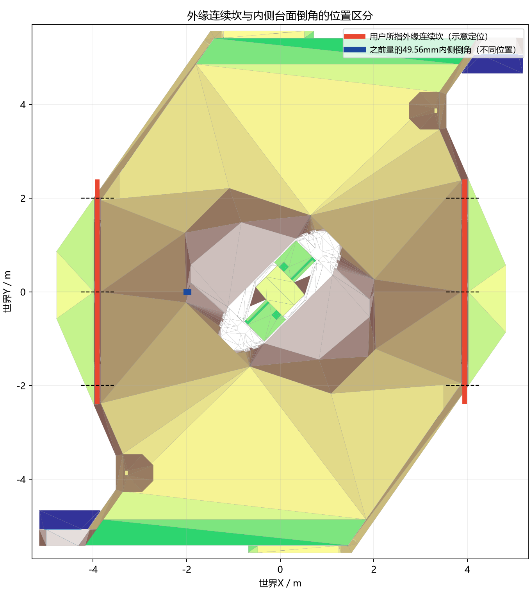
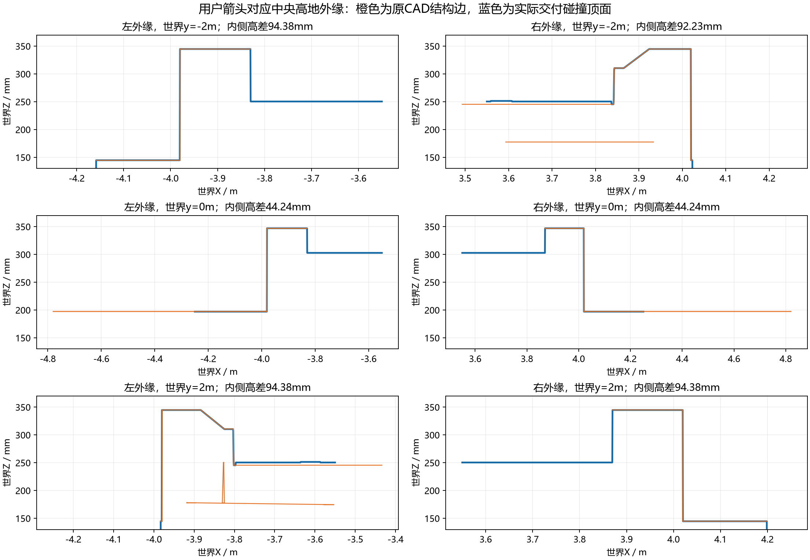
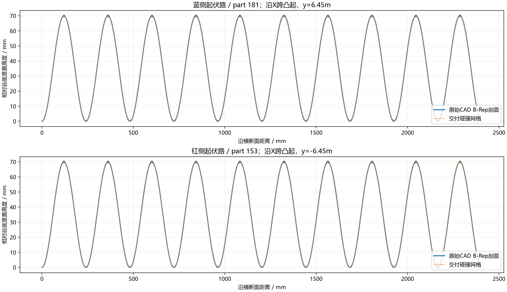

# RM2026 中央高地外缘凸坎与起伏路几何审查

审查日期：2026-10-09。依据用户箭头、规则书完整相关页、给定 CAD 的原始 B-Rep 截面和现有交付碰撞网格。仅静态审查，没有新 SDK、GPU、PPO、实物测量或生产地形修改。

## 主要结论

用户箭头指的是中央高地左右外缘的连续窄条凸坎及其过渡，不是中央二级台面内侧的 part383/BREP_424 倒角。此前把用户的“中心岛的坎”对应为该内侧 49.5617556 mm / 45° 倒角，位置对应错误；该倒角的原测量保留，但不能作为本次用户指定外缘凸坎的替代证明。

外缘凸坎是实际实体碰撞结构，不只是油漆线。规则书 V1.5 的图4-27 C向视图明确标注内侧300 mm、外缘350 mm，对应设计上的50 mm高差；条带宽150 mm。给定 V2.0.0 CAD 的不同位置/接近方向具有不同相邻支撑面高差，不能把整圈替换为一个统一50 mm圆滑坡或45°倒角。

起伏路的规则名义尺寸为70 mm峰谷高度、240 mm重复节距。给定 CAD 原始曲面测量与之基本相符，未发现米/毫米误换、把高度做成140 mm、镜像方向丢失或起伏被抹平的证据。交付网格沿本次两条剖面相对 B-Rep 最大竖直误差约1.44 mm，主要已出现在原始曲面三角化阶段，不能称几何字节精确。

## 资料版本与坐标

| 资料 | 用途与限制 |
|---|---|
| 用户提供规则手册 V1.0.0（20251021） | 印刷p54图4-27中央高地；p59图4-34起伏；p58前哨站；p60公路。原图没有新版C向视图，不能用400减350推断箭头处高度。 |
| 本地规则手册 V1.5.0（20260519） | 印刷p54图4-27增加C向300/350 mm；印刷p61图4-36起伏仍70/240 mm。 |
| 用户给定 RMUC2026_V2.0.0.stp | 原始文件SHA256独立重核：8dfe9ebd761e44d91361b3e593bc05416329112217b58cb35800b3cde2ffae33。V2 CAD与V1图纸不应冒称同一版本。 |
| 原始 terrain_subset.stp / 原提取网格 / arena_collision.npz | 原B-Rep截面、原始1 mm deflection三角化、交付碰撞网格三层独立比对；没有修改这些文件。 |

官方规则目录已有后续V2修订：https://bbs.robomaster.com/wiki/20204847/809871?source=7 。本次没有取得并逐页核对最新V2规则全文，因此结论限定给定CAD及上述两份完整相关页，不称最新全国赛规则全项认证。

世界坐标为CAD原轴，仅mm转m及平移，未改轴/缩放波形。场地两半原有约1.5°倾斜被保留。规则图G基准与交付世界Z零点不同；局部障碍高差应从真实相邻支撑面计算，不用绝对Z误当高度。

## 箭头处外缘凸坎

外缘相关结构：part0/1/2/4（BREP_1/3/5/7）；岛内相邻主面part82/BREP_121。y=0处左条带X=-3.98至-3.83 m，右条带X=3.87至4.02 m，宽150 mm。该截面存在竖直边壁，不能套用内侧part383的45°倒角。

下表为世界坐标选定截面，**是有限位置样本，不是整圈最大/最小值**。内侧采样X=±3.7 m、条带采样X=±3.92 m，外侧采样X=±4.1 m；过渡点的条带采样可能落在过渡斜面，未来路线必须沿完整轮迹再测。

| 世界y / 侧 | 凸坎相对岛内侧 | 凸坎相对外侧 | 外侧支撑说明 |
|---|---:|---:|---|
| 0 / 左右 | 44.241 mm | 149.929 mm | 外侧较低平台，不能仅用约5 cm内侧差代表从外上岛难度 |
| -2 / 左 | 94.381 mm | 200.069 mm | 平台/坡面过渡 |
| -2 / 右 | 92.228 mm | 不作为“路坎高度” | 外侧采样已落普通低地，而非同一邻接平台 |
| +2 / 左 | 94.381 mm | 不作为“路坎高度” | 外侧采样已落普通低地 |
| +2 / 右 | 94.381 mm | 200.069 mm | 平台/坡面过渡 |

因此，V1.5名义50 mm、给定CAD中心44.24 mm和过渡92-94 mm应分别记录。它们反映版本、位置和邻接面不同，不足以单凭数字认定CAD损坏，也不能在训练中直接统一重缩放。

part280/281为650 mm宽、约100 mm厚的独立六角块，位置及尺寸与规则p58图4-32前哨站底座相符（图中台面300、底座顶400）。这是由几何/图纸位置作出的对应推断，应从普通通行路坎中分开，不能继续仅凭旧feature名central_edge_blocks认作另一条用户指定路坎。

## 双方起伏路

| 参数 | 规则名义值 | 给定CAD测量/解释 |
|---|---:|---|
| 峰谷高度 | 70 mm | 原始曲面相对当地基面法向69.999995 mm；世界竖直约70.02399 mm，1.5°基面造成坐标差异 |
| 同相邻峰节距 | 240 mm | 原B-Rep极值240.6336-240.6506 mm，均值约240.642 mm；较图纸约0.27%，保留给定CAD，不偷偷重缩放 |
| 沿波形区间长度 | 图中局部尺寸不单独规定总长 | CAD剖面2406.423 mm，约10个凸起，10峰/9个内部谷 |
| 沿凸起横向宽度 | 本次以CAD为准 | 当地切向宽约2084.5 mm；不是直接拿倾斜后的XY包围盒2090.853 mm当净宽 |
| 波形方向 | 图示连续凸起 | 沿CAD X跨凸起，棱线沿当地横向；双方镜像，保持坡向和波峰/波谷 |
| 交付网格误差 | 不等于精确曲面 | 两条有限剖面最大竖直误差约1.4373 mm；原三角化相对B-Rep约1.4374 mm，主要不是后续碰撞简化新增 |

原始曲面计算了极值后才计算节距；三角网格表观顶点位置可导致229/244 mm等假“峰间距”，不能据网格顶点直接说实际曲面周期错了。1.44 mm是本次有限剖面竖直误差，不是整场最大Hausdorff误差或SDK动态接触认证；旧0.475 mm网格对网格采样距离与这里不是同一种误差量。

当前E1的1-2 cm杆、0-1 cm起伏是渐进浅课，**并未覆盖RM的70 mm连续起伏路**；MuJoCo小起伏试玩也不能证明RM实地范围已通过。

## 其他相关尺寸核查

中央连接坡规则标10.5°；给定CAD对应主坡世界水平角约12°，相邻地面约1.5°，相对当地地面10.5°。应区分绝对世界坡角和相对地面坡角，不能据12°就认定坡度读错。

V1图中梯形高地有43°/23°面，公路连接坡标11°；V1.5公路还标15°。这些大几何是后续具体目标，不等于当前浅课≤10°范围。公路狗洞图示净开口700 mm宽、250 mm高；顶部桥面宽800 mm不能当洞内净宽。底座、桥面、凸坎、主坡、内侧台面与空中技能应保持分区。

## 计划修正要求

1. 用户指定中心岛凸坎映射为左右外缘连续条带及过渡，原part383倒角保留为另一独立几何。旧测量/旧trial不改写；旧“该倒角就是用户所说路坎”的解释被本澄清替代。
2. E1未来通行按真实外侧支撑面->凸坎顶->岛内路面整条路线，覆盖左右位置、上下行、倒退、斜向、停后起步，yaw0。必须有坎前接近、两轮实际越坎和落地稳定的完整root-q/接触/轨迹证据，不在坎后reset代替。
3. 中心44 mm样本并不自动入课。过渡约94 mm、外侧约150/200 mm差及竖直边壁分别补几何/接触/ground/reset范围；保留原首档≤5 cm/≤10°边界，不因名称“小路坎”越级。
4. RM起伏路后续用原70 mm/约240 mm连续曲面及真实方向，先通行再各地点左右纯转/定向移动分档。原小陀螺狗洞内、台阶踏面/边缘及台面排除不变；区域mask不作为actor/gate特权输入。
5. 本次不据静态审查安装新地形、扩大DR、宣称技能毕业或硬件标定。主计划SHA、生产runtime/GPU/PPO/canonical和S8授权边界保持。

可复核数值在GEOMETRY_AUDIT.json；原始曲面读取/网格射线/极值代码在audit_terrain.py。源CAD SHA独立重核，审查前后terrain_subset.stp字节相同。
