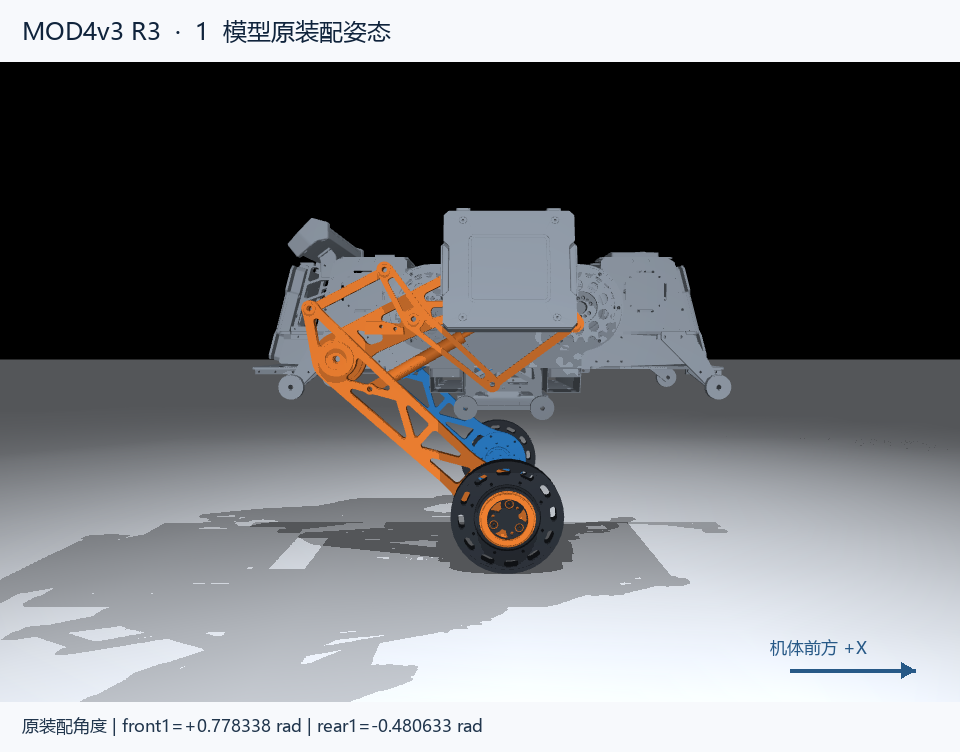
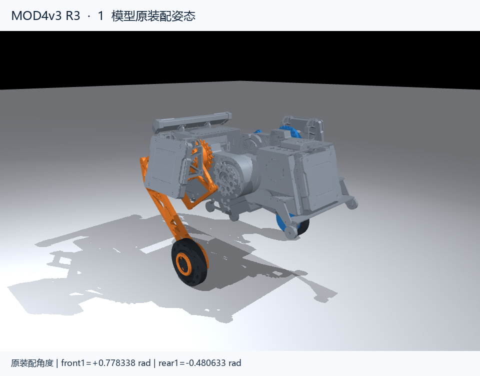

# 按模型零位标定

用户最终指令：“零位就按照模型的零位来”。本工程采用先前讨论的模型默认初始姿态，来源为 MOD4v3 `runtime_config.json` 的 `initial_joint_positions`；该姿态的 `Newton_initial_joint_displacements` 为 0。它不是把所有闭链的绝对几何关节角写成 0。





| 固定策略顺序 | 关节 | 标定姿态中的绝对模型角 rad | 计划总线 | SlaveID | MasterID |
|---:|---|---:|---|---:|---:|
| 0 | left_front1 | +0.7783382074 | CAN1 | 1 | 0x11 |
| 1 | left_rear1 | −0.4806332577 | CAN1 | 2 | 0x12 |
| 2 | right_front1 | +0.7783382074 | CAN1 | 3 | 0x13 |
| 3 | right_rear1 | −0.4806332577 | CAN1 | 4 | 0x14 |
| 4 | left_wheel | 策略不使用轮角 | CAN2 | 1 | 0x21 |
| 5 | right_wheel | 策略不使用轮角 | CAN2 | 2 | 0x22 |

表中 CAN ID 是分配方案，需要在实际驱动中核对/设置；不是从实车读出的值。四个关节为 DM8009，两个轮子分别为 DM3519＋独立 DM3520。策略顺序来自冻结交付合同，不能直接套模型目录中其他任务使用的通用 action order。

1. 让机器人无输出，摆成上图的模型初始姿态。记录四个关节编码器的实际角度。可以在达妙工具中设置该姿态为电机零点，再读取确认；也可以保留驱动原零点，把此时读数作为软件 `encoder_zero`。本固件不会自动执行 `0xFE` 保存零位。
2. 按模型正方向小幅转动各关节，核对 `sign=+1/-1`。四个腿的 `model_reference` 保持表中值。若有外置传动，填实际 `external_reduction`，其定义为电机输出轴转角/模型关节转角。
3. 核对左右轮速度和转矩方向。3519 的速度已经是减速后的输出轴 rad/s，转矩已经是输出轴 N·m；其反馈位置才是减速前的转子角。内部约 19.2 的减速比不能再用于除速度或转矩。
4. 核对 IMU 转换后的机体坐标：X 向前、Y 向左、Z 向上。水平静止应约为 `gravity=[0,0,-1]`，转动时角速度轴和符号应与模型一致。配置里的单位矩阵是待核实模板。
5. 读回六驱动的 MIT 模式及 PMAX/VMAX/TMAX，确认总线和反馈 ID。完成实测后再将 `MOD4_HARDWARE_CALIBRATION_VERIFIED` 改为 1，重新编译。

软件映射：

```text
q_model = q_ref + sign × (p_encoder − p_zero) / internal_ratio / external_reduction
qd_model = sign × v_driver / external_reduction
tau_driver = sign × tau_model / external_reduction
```

四个 DM8009 的 `internal_ratio=1`。轮角不进入策略观测，因此 3519 上电位置清零不会改变策略的轮角输入。`p_zero` 是标定时读出的驱动位置，不是让模型强制走到某个位置的控制命令。正常启动也不需要先把四条关节目标角全部发成 `0 rad`。

模型的策略参考 `q0=[0.7783382074,-0.4806332577,0.7783382074,-0.4806332577,0,0]` 保留不动。只校正驱动坐标映射，不改变 actor 输入/动作语义。

## 原板级接口

原 ZIP 是 STM32F407IGHx 工程，代码中 CAN1 为 PD0/PD1、CAN2 为 PB5/PB6，时序按原板 42 MHz CAN 时钟得到 1 Mbit/s。这里是 MCU 的 RX/TX 引脚，电机接板上 CAN 收发器的 CANH/CANL；不能把 MCU 引脚直接当电机 CANH/CANL。

USB 使用原板 CDC。真实设备路径在上位机 `device` 参数中设置。物理允许条件沿用 DT7：`s[0]` 中位且 DBUS 在线；再加上上位机明确 ARM 上升沿，才允许使能。

后折起立姿态的前/后模型角分别是 `2.2480165120 / 0.4971227139 rad`，与本页标定姿态不同。先前临时采用它作参考的配置保留在 `reports/superseded/rear_ground_hardware_config.h`，仅供历史追溯，不用于最终固件。
