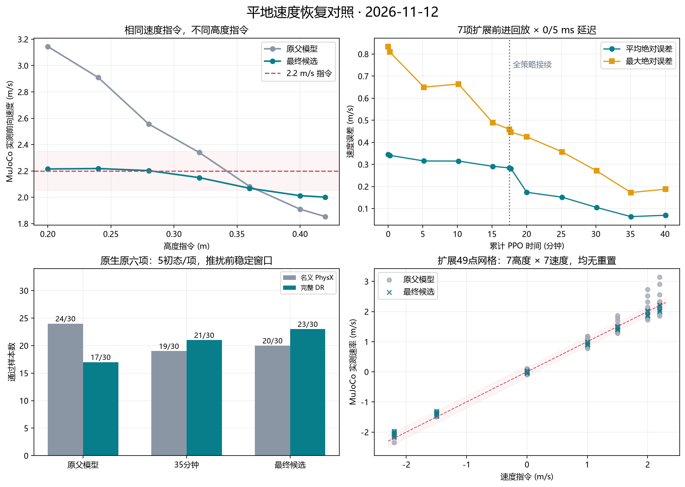

# 平地速度恢复：完成结果与保留限制（2026-11-12）

本轮把原六项名义MuJoCo任务恢复到60/60，同时保留原有抬高上阶、下阶能力；完整DR原生对照也改善。**跨引擎偏差尚未全部消除：名义PhysX前向仍欠速，高站姿扩展网格也仍有残余。** 不把本轮写成所有分布、所有站姿已经精确追踪。

保留最终完整PPO候选：`weights/selected_flat_speed_candidate.pt`，iteration **24692**，SHA256 `979e355a563b3057d7509e9e5ef33e7a364906bd80bd16789ad80df654efa64d`。原用户命名的Rough-v1 120m/iter24482/7cc1fc6d…仍冻结，未覆盖。

## 主要结果

以下是同一R3资产、相同腿100Hz/轮400Hz反馈下的名义MuJoCo单初态12秒回放，尾4秒统计。完整十初态结果另列，避免将单次回放冒称统计验收。

| 任务 | 指令 | 父模型实测 | 最终候选实测 |
|---|---:|---:|---:|
| 普通高度前进 | 2.0000 | 2.3211 | 2.0188 |
| 普通高度前进 | 2.2000 | 2.5557 | 2.2023 |
| 0.22m高度前进 | 2.2000 | 3.0330 | 2.2137 |
| 0.38m高度前进（扩展） | 2.2000 | 1.9783 | 2.0392 |
| 0.40m高度前进（扩展） | 2.2000 | 1.9091 | 2.0121 |
| 普通高度倒退 | -1.5000 | -1.3473 | -1.3951 |
| 完整旋转 | 14.1372 | 14.3573 | 14.1315 |
| 普通高度停车 | 0.0000 | 0.0876 | 0.0335 |

- 原固定六项、十个初态：35m和最终模型均 **60/60，0重置**。原阈值是前进2.0/2.2误差±0.15m/s、倒退−1.5误差±0.20m/s、旋转14.137rad/s相对2%、两站姿高度±0.02m。见 `evidence/fixed60_035m/` 与 `evidence/fixed60_final/`。
- 扩展49点网格（7高度0.20～0.42 × 7速度−2.2～2.2，0ms名义物理）：参考误差线内 **27/49→45/49**；平均绝对误差 **0.2089→0.0757m/s**，最大误差 **0.9445→0.2263m/s**；两者均0重置。这是扩展诊断，不新造一条原课程晋升门槛。
- 原手动台阶条件：0.365m/0.40m抬高后均能上两级各16.5cm、到33cm平台；下阶保留。父、5m、20m、35m、最终同协议单次对照一致。默认0.28m/1.0m/s上阶仍会停在台阶前，不能冒称任意高度都能上。见 `evidence/stair_parent_matched_r2/`、`stair_005m_r2/`、`stair_020m/`、`stair_035m/`、`stair_final/`。

## 原生PhysX与完整DR

270环境同批：原父/35m/最终 × 名义/完整DR × 9任务 × 5初态。以下只统计原六项，即每模型/条件30样本；另3项高度/停车扩展不混入正式任务计数。机器人、DR样本、噪声、外力、速度推扰在模型间配对。为避免12秒回放离开有限平面，平地仅从4行延长到8行，材质与机器人保持。

3.6～5.98秒窗口包含5.5秒外力/力矩，6秒施加速度推扰，8～12秒再统计。不是从存活样本中挑均值。

| 模型 | 条件 | 6秒速度推扰前原六项 | 推扰后原六项 |
|---|---|---:|---:|
| 原父 | 名义 | 24/30 | 25/30 |
| 原父 | 完整DR | 17/30 | 18/30 |
| 35m | 名义 | 19/30 | 19/30 |
| 35m | 完整DR | 21/30 | 20/30 |
| 最终 | 名义 | 20/30 | 20/30 |
| 最终 | 完整DR | 23/30 | 24/30 |

三组所有原生样本均0重置、numerical=0，动作观测槽误差=0，电机包络越界=0。详见 `evidence/native_final_r1/RESULT.json`、完整 `trajectory.npz` 与 `NATIVE_FORMAL_METRICS.json`。

完整DR推扰前均值：2.0m/s指令，父约2.262、最终约1.928；2.2指令，父约2.390、最终约2.068。名义PhysX最终前向约1.783/1.973，仍欠速。因此选择最终点作为综合实验候选，**没有把它晋升为所有后端已经过关的成熟替代品**。35m在少量前进点误差略小，但最终点在完整DR和49点网格更好。

## 原因判断与被排除的解释

1. 这不是只漏了超速惩罚。父与本轮实际保存配方均为 `−1.5e²`，sigma=1，其中 `e=command_vx−body_vx*cos(pitch)`，并保留权重1.2的指数奖励；超速与欠速平方项对称。时间积分仅乘一次0.02s。没有把训练指令改回2.7，实际范围仍为±2.2m/s。
2. 平地误差确实依赖站姿。父模型低站姿前向超速、高站姿欠速，在12秒回放尾段已形成稳态，不能都解释为加速需要时间。旧93例腿/轮通道交换仍说明腿控改变会经姿态、关节/轮速观测和前一动作反馈，改变轮速均衡点。35维actor没有直接基座线速度，78维critic才有特权速度。
3. 原生与MuJoCo存在独立的接触/反馈差异。原生24边凸轮面和100Hz显式速度环出现较大轮速波动；仅调阻尼/armature、TGS外力迭代、速度迭代、摩擦距离、编码器差分都没有单独消除差距。球体诊断会改变轮面与接触流形，不能用作原机器人验收；SDF圆柱与减小轮增益也未解决全部问题，均未采用。地面摩擦乘积差异也只作诊断，额外ground1.0实验没有消除差距，没有改写本轮配方。
4. 轮速度反馈节拍有可计算的风险：单自由轮近似 `J≈0.000753+0.00099856=0.001752 kg·m²`、`Kd=0.6`，零阶保持反馈的速度偏差倍率约为 `1−Kd*T/J`。T=10ms时约−2.43，T=2.5ms时约0.144。它解释为何卸载/接触切换会激发振荡或饱和极限环，但不是整个闭链机器人稳定性的证明。实测只把轮反馈改到400Hz后，典型名义轮速标准差从约10～14降至约2～3rad/s，仍未消除所有稳态偏差。
5. 只修轮输出行不足。静态拟合候选在闭环中显著恶化，已拒绝；在线只训练轮输出行也把部分低姿超速改善转移成高姿欠速。恢复原框架的全策略学习后，常用高度的2.0/2.2、低姿前进、倒退等一起改善，证明不需要从零重训，也不能把问题当成单独的轮输出常量偏置。

原始失败与未采用结果保留于 `evidence/DIAGNOSTICS_SUMMARY.json` 和各实验目录；原地面材质、robot.usd、robot_physx.usda、import_contract、MJCF均未改。前面静态拟合的PT是失败原件，不是被选中的模型。

## 实际训练方法与预算

原始父：完整Rough-v1 120m，SHA7cc1fc6d…；同一原RSL-PPO5框架，35/78/6接口，当前R3资产，TGS32/4，2mm单环境闭链重置，mimic/非有限/电机包络保护保持。物理2.5ms、腿PD10ms、**轮反馈2.5ms**、策略20ms，60/2腿增益和0.6轮增益保持。全DR范围与约20%名义混合保持，平地专项采样50%直行/20%停车/30%原采样，0.20～0.42m高度。

- 第一段：512env、LR1e-4 fixed、clip0.1、3epochs、rollout24；只学习两个轮输出行，其他actor参数与STD冻结，critic更新；旧修改张量Adam矩清空。实际 **1050.424s**，所有5/10/15m与最终完整PT保留。
- 第二段：从第一段完整final接续，LR3e-5，其他环境/奖励/采样不改；恢复全actor与STD学习，明确清空旧actor Adam矩，保留critic状态与全局RNG。fresh physical episode，不宣称逐物理状态恢复。实际 **1355.338s**，按全局20/25/30/35/40m保存。
- 合计 **2405.762s（40分5.76秒）**，含最后一个完整PPO迭代的正常时间箱越界，未另开40分钟。累计 **210次PPO更新**。启动漏seed的失败发生在环境/优化器构造前，未计作PPO更新。

完整 `.pt` 保存actor/critic/STD、17项Adam、LR、CPU/CUDA/Python/NumPy/reset RNG、当前DR记录等；不是仅actor权重或地址。512env导致奖励/DR张量比原4096env小，文件较原父小不能据此判成缺失PPO状态。实际配方为TRAIN_PLAN.json与TRAIN_PLAN_P2.json，执行回执分别在两个training_round目录。

## 使用与保留边界

`weights/selected_flat_speed_candidate.pt` 是完整实验候选，原成熟手动包未覆盖。新候选要求本轮**400Hz轮反馈**配方；不能将旧100Hz使用包不改控制时序就标成同配方部署通过。本轮没有部署实车、没有宣称新固件已核实。

4096环境数值稳定性没有在本轮重验；本轮512env训练及270env固定原生对照的结论按实际规模保留。额外高站姿快速/倒退点的残余和名义PhysX欠速均继续记账，避免用MuJoCo的60/60替代完整DR毕业。

实际使用的外部launcher、SCUT包、11份固定源文和reset bank均复制到runtime_dependencies，并附SHA清单；原PLAN实际路径不改，迁移机器可按相对映射重建路径。机器人资产与回放工具已在原成熟交付包中。完整模型清单见evidence/MODEL_ARCHIVE_INDEX.json及总MODEL_REGISTRY。
