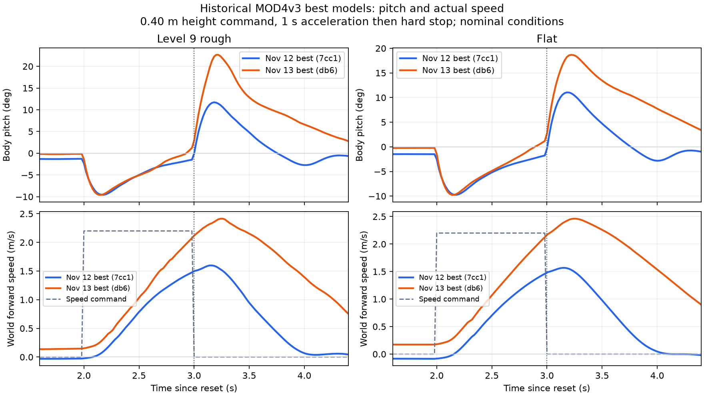

# 两份历史“最牛逼模型”的俯仰核查（2026-11-16）

11月12日的命名模型是Rough-v1 120分钟点，iteration24482，SHA256 `7cc1fc6deeee3d3aba8ae8d2da31dce200079fb229a145f1cbb1cd3bfabea103`；11月13日的命名模型是综合默认冻结权重，iteration25331，SHA256 `db6e9ccf5c6d4d05a68633fd82861d903c4c52fcc1a6dd89132e55e2a4bf1283`。二者都是MOD4v3 / HW300N60 R3，不能混为同一个检查点。本次为冻结评测，没有PPO更新，没有替换默认权重。

## 同指令启停结果

沿用既有名义协议：平地level0和官方random_uniform level9，0.28/0.40 m高度指令×1.2/2.2 m/s速度指令；共8条14秒轨迹，先站立2秒，再1秒硬起步、2秒硬停车，正反交替。统计实际机身重力投影俯仰。物理2.5 ms、腿100 Hz、轮400 Hz、策略50 Hz、闭链2 mm guard。0 ms延迟、无随机推扰，不作为完整DR验收。RMS为各地形4个工况各自RMS的均值；启动、急停为对应窗口绝对俯仰峰值的最大值。

|模型|地面|俯仰RMS均值|启动最大俯仰|急停最大俯仰|完整回合|
|---|---|---:|---:|---:|---:|
|11月12日 7cc1|9级崎岖|4.49°|10.78°|15.30°|4/4|
|11月12日 7cc1|平地|4.54°|10.77°|15.14°|4/4|
|11月13日 db6|9级崎岖|5.68°|12.29°|22.64°|3/4|
|11月13日 db6|平地|5.55°|12.21°|18.67°|3/4|

11月12日模型本次8/8完成；11月13日既有基线在两个0.40 m、2.2 m/s工况分别于9.66/9.46秒到达地形边界，并非跌倒。两份的全程RMS覆盖时长因此不完全相同。11月13日参考数据复用原始RESULT及NPZ；评测源码逐行比对，仅R2追加三个角速度汇总字段，物理、轨迹、角度指标计算一致，replay guard文件字节相同，见`evidence/EVALUATOR_EQUIVALENCE.json`。

## 实速差异限制了对比结论

旧模型在同样指令下的俯仰更小，但高站姿实际加速更慢。9级崎岖、0.40 m、2.2 m/s指令工况，第一次急停前世界水平实速：11月12日约1.476 m/s，11月13日约2.078 m/s；第一停0.8秒内俯仰分别11.721°/22.645°，位移0.905/1.734 m。平地对应实速1.459/2.125 m/s，第一次急停峰值11.045°/18.673°。这些值不能当作相同实际速度的制动能力比较。

0.28 m、2.2 m/s指令的9级崎岖工况，首次急停前实速更接近（1.987/2.040 m/s）；全协议急停峰值15.300°/16.943°，差距缩小为约1.64°。因此更早模型值得保留为俯仰参考，但这些数据不足以说明后续训练单独损坏了姿态控制，也不足以据此晋升或回退默认模型。

水平实速由50 Hz世界x位置后向差分求得；不使用已知存在姿态投影偏差的旧e.vx指标。完整逐工况值和0.8秒位移定义见`evidence/MATCHED_FIRST_STOP_COMPARISON.json`。

## 证据与复现

新测11月12日完整结果：`evidence/nov12_matched_pitch/RESULT.json`。原11月13日结果副本：`evidence/NOV13_EXISTING_BASELINE_RESULT.json`。执行命令、源检查点及评测脚本指纹：`PLAN.json`。原始轨迹、权重和引用源码的真实路径、大小及SHA256：`evidence/ARTIFACT_INDEX.json`。大型NumPy和模型原件保留本地及各自原归档路径，本次提交索引；新生成的文本报告、结果、日志和图随本次trial归档。
