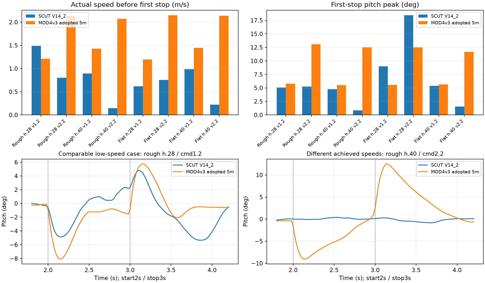

> 2026-11-16后续条件核查：原配回放中SCUT实际轮地摩擦为5.5，MOD4v3为0.9，接触硬度也不同；本页的同地形/同指令结果不代表同接触条件或同实速。已补做[统一材料与同实速详细对照](../MOD4V3_SCUT_MATCHED_PITCH_COMPARE_20261116/REPORT.md)，请以新报告区分前进/后退、角度/角速度与停车路程。原始结果和奖励系数读回保持。

# 华南虎奖励与11月16日低俯仰模型差距分析

本次已按用户指令采用5分钟完整检查点为“11月16日俯仰较低模型”，SHA c874a1af，iteration25362，作为当前综合默认。旧db6保存回退。没有新增训练、物理回放或改奖励；本报告复算两方已保存的8条完整14秒轨迹与固定配置。

## 1. “两倍”出现在哪里

| 地形 | 指标 | 华南虎 | 已采用MOD4v3 | 比值 |
|---|---|---:|---:|---:|
|难度9崎岖|RMS均值|1.704°|3.850°|2.26×|
|难度9崎岖|启动峰值|4.867°|11.122°|2.29×|
|难度9崎岖|急停峰值|6.983°|13.562°|1.94×|
|平地|RMS均值|2.116°|3.890°|1.84×|
|平地|启动峰值|5.727°|11.028°|1.93×|
|平地|急停峰值|18.463°|13.370°|0.72×|

崎岖RMS约2.26倍、启动约2.29倍，但急停为1.94倍；平地RMS约1.84倍、启动1.93倍，急停仅0.72倍。不能把所有指标合称超过两倍。

## 2. 同指令并非同实速

| 工况 | SCUT首次入刹实速 | MOD4v3首次入刹实速 | SCUT首次急停峰值 | MOD4v3首次急停峰值 |
|---|---:|---:|---:|---:|
|random_uniform_for_rm_h0.28_v1.2|1.489 m/s|1.210 m/s|5.085°|5.754°|
|random_uniform_for_rm_h0.28_v2.2|0.799 m/s|2.134 m/s|5.241°|13.064°|
|random_uniform_for_rm_h0.4_v1.2|0.891 m/s|1.424 m/s|4.771°|5.503°|
|random_uniform_for_rm_h0.4_v2.2|0.147 m/s|2.072 m/s|0.840°|12.508°|
|plane_for_rm_h0.28_v1.2|0.614 m/s|1.194 m/s|8.993°|5.544°|
|plane_for_rm_h0.28_v2.2|0.755 m/s|2.151 m/s|18.463°|12.523°|
|plane_for_rm_h0.4_v1.2|0.985 m/s|1.445 m/s|5.369°|5.623°|
|plane_for_rm_h0.4_v2.2|0.223 m/s|2.140 m/s|1.549°|11.679°|

最接近且不利于我们解释的崎岖0.28m/1.2m/s工况：SCUT实际更快(1.489 vs1.210m/s)，首次急停5.085 vs5.754°，差距约13%；启动仍4.867 vs8.131°，确实还有动态姿态差距。高速工况则比较了2.1m/s制动与0.15–0.80m/s制动，不能从峰值比例归因奖励或策略优越。

## 3. 华南虎的直接俯仰奖励已存在于我们基础奖励中

`gx=sin(pitch)`，`A(vcmd)=2*exp(-vcmd^2/3)+2`。SCUT每秒基础直接俯仰项为 `-2*A^2*gx^2 + exp(-gx^2/0.02)`，并有 `-.05*(wx^2+wy^2)`。零速平方增益32，高速2.2m/s约11.505；停车比行驶更强回正，指数项从0°稠密生效。保存的速度直立、速度高度、姿态高度门控均false。

我们原生基础已经使用相同项；目标615环境另加 `-.25*A^2*gx^2 -2*(1-exp(-gx^2/.02)) -.05*wy^2`。同一普通接地状态下合并为 `-2.25*A^2*gx^2 +3*exp(-gx^2/.02)-2`，因此不能把现有差距解释为漏掉SCUT姿态项。

## 4. 新核出的关键差异：速度平方有效强度为240倍

不能只比较外部权重。源码原始量是 `(error*lin_vel_xy_square_sigma)^2`。SCUT保存值为外部-0.1、内部sigma0.25，因此有效 `-0.00625*e^2`；我们的实际STARTUP与选中检查点为外部-1.5、sigma1，实际 `-1.5*e^2`。外部权重15倍，完整有效系数240倍。指数速度奖励的误差clamp=1不会裁掉此独立平方项。

相同2.2m/s误差时，两者每秒平方成本为0.03025与7.26；实际20ms单步为0.000605与0.1452。这是同状态的奖励代数比较，不是整个回报/梯度比。我们的速度与姿态取舍强烈偏向保持速度；这与本次实测速度差一致，但尚无当前学生单项消融去量化贡献。

| 项 | SCUT权重 | MOD4v3原生权重 | 绝对值比 |
|---|---:|---:|---:|
|track_lin_vel_xy_square|-0.1|-1.5|15×|
|track_lin_vel_xy|1|1.2|1.2×|
|stand_still_lin_vel|-1|-2|2×|
|flat_orientation_y_v|-2|-2|1×|
|flat_orientation_y_exp|1|1|1×|
|ang_vel_xy|-0.05|-0.05|1×|
|action_rate|-0.01|-0.05|5×|
|action_smoothness_leg|-0.05|-0.1|2×|
|action_smoothness_wheel|-0.01|-0.03|3×|
|joint_torque|-1e-05|-0.0001|10×|
|wheel_power|-1e-05|-0.0001|10×|

停车L1残速成本2倍；动作一阶变化5倍、腿二阶2倍、轮二阶3倍；关节扭矩/轮功率10倍。更强的动作与能耗惩罚会给突发急停所需的快速腿轮调整增加代价。这些系数事实已确认；“因此延迟了多少毫秒”尚未用当前学生物理消融测量。

## 5. 旧动作锚与示范覆盖仍限制修复

1433/2048环境继续全6动作模仿原db6(系数1)，615/2048用于启停PPO。目标环境虽不受keep mask限制，训练每个minibatch仍有256条旧db6高站姿腿动作锚，系数0.25，直接约束同一个actor。两方环境标记不进入35维actor，状态分布重叠时可能形成目标冲突；目前只有机制证据，没有量化梯度归因。

本次新轮协调示范只覆盖高度>=0.38m、速度>=2m/s、硬停车后100ms(5拍)，仅轮动作；不覆盖起步，也不覆盖0.28m低站姿。选中模型最大的起步峰值正出现在低站姿高速工况，该工况不受新增轮示范覆盖。基础姿态PPO仍覆盖该工况，因此这不是完全未训练；它说明训练示范覆盖不足。

## 6. 物理和控制差异不能归给奖励

SCUT使用作者V14_2、1ms物理和1kHz腿/轮PD；MOD4v3使用不同的机体/电机/弹簧，2.5ms物理、100Hz腿与400Hz轮PD，策略均50Hz。腿反馈周期差10倍、轮差2.5倍，是潜在动作响应差异。没有同机体同频率的策略消融，因此不能宣称改成1kHz就能复制SCUT，亦未改动实际控制合同。

若主要靠机身倾斜移动质心，倒立摆准静态量级tan(theta)≈a/g；1秒达到2.1m/s对应约12°，与我们的9–11°起步峰值量级接近。腿部移动轮位/质心可以改变这一关系，12°不是机械最低俯仰或不可改善结论。

## 7. 判断与下一步

有把握的判断：汇总中的两倍含有严重实速混杂；在相对接近的低速崎岖制动工况，差距已缩到约13%，但起步姿态差距仍真实存在。最强的奖励差异是240倍有效速度平方成本及更强的动作/能耗约束，而直接姿态项并不缺。旧教师动作锚、新示范只覆盖高站姿停车和不同控制带宽，是剩余差距的具体机制候选。

后续应从已采用5m模型出发，以同实际入刹速度/停车距离的固定协议比较；优先验证起步与低站姿腿轮协调，再做保留平地60/60、正向5/5、下阶5/5的单因素验证。-1.5速度奖励是现有训练合同，不为追低角度直接削弱。当前用户仅授权采用和分析，本次没有修改奖励或追加训练。

证据：[轨迹复算](evidence/TRAJECTORY_COMPARISON.json)、[奖励完整系数](evidence/REWARD_COMPARISON.json)、[控制与教师保留](evidence/CONTROL_AND_RETENTION.json)、[输入SHA索引](evidence/INPUT_INDEX.json)。所有原评测和失败保持；本报告为本次独立采用/分析记录。

读取过程记录：AGENTS引用的Git政策在当前稀疏工作区未落盘，已从HEAD的Git对象读取；部分脚本初次按名称查找未找到，随后按现有文件定位。持久Node REPL未能初始化，使用既有Python环境完成。以上均未改变训练/评测原件。

采用完整性与配置回读共11项通过，见[evidence/VERIFICATION.json](evidence/VERIFICATION.json)。首次源码AST读取使用了错误编码别名，后改为utf-8-sig并完成验证；原失败与修复见[VERIFICATION_READER_REPAIR.json](evidence/VERIFICATION_READER_REPAIR.json)。
