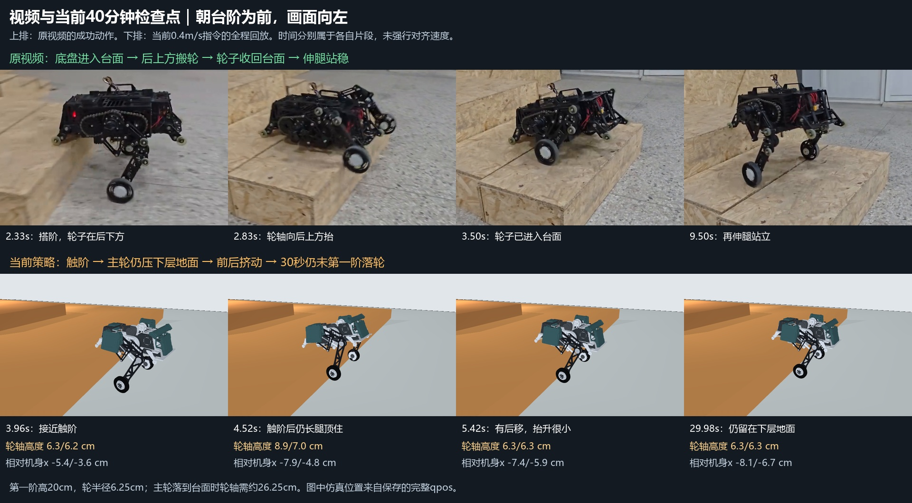
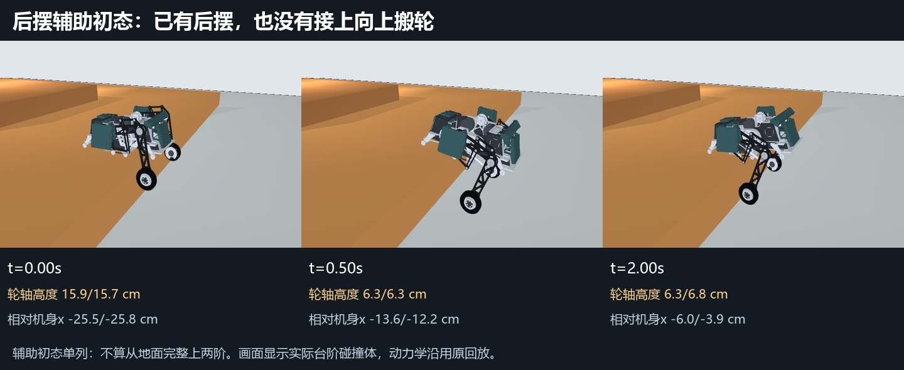

# 低速上台阶：原视频与40分钟学生检查点对照

当前主要动作缺口是支撑后的后上方搬轮。视频完成底盘搭阶、轮轴向后上方移动、轮子进入台面、再伸腿站稳；当前学生能接近和触阶，也有轮轴相对后移，但主轮仍主要压在下层地面，未接上越沿落轮。

检查点：model_040m.pt，SHA256 771550dba9f7cd64fe2301645d82ed65d62819716ed2131e18a555bfa98c4c59。这是正确世界高度配方首段关闭时的完整学生，也是本轮剩余两小时训练的实际接续父状态。主机已于2026-11-15 02:53:03继续原配方，预计04:12:59结束PPO；本诊断在本机只读回放，没有改训练配方。

参考：C:/Users/lulunomaro/Desktop/43574887781-1-192.mp4，SHA256 360fd0401a377f15cb582dd0416328bd75b671136271134b3db0f5e88ac8e43e。复看第一次上阶原帧70/85/105/285（约2.33/2.83/3.50/9.50秒），结合既有连续原始帧审阅记录MOD4V3_VIDEO_LOW_SPEED_STAIRS_20261114。视频速度、接触力和腿机构精确尺寸未做图像标定；仿真20cm台阶不冒称与录像尺寸完全相同。

| 环节 | 视频可见动作 | 当前40m固定MuJoCo回放 |
|---|---|---|
| 搭阶 | 底盘进一步进入台面，进入低姿过渡 | 底盘在阶沿附近前后调整；0.4代表回合机身原点最多进入阶沿约6.75cm，未持续推进 |
| 后摆与抬轮 | 轮轴明显向后上方移动并离开下层 | 0.4代表回合触阶后两轮相对后移最大约6.52/7.60cm；轮轴最高仅9.67/8.47cm |
| 越沿落轮 | 主轮进入上层台面 | 第一阶20cm，半径6.25cm，落轮中心应约26.25cm；当前0.4/0.6两代表全程均无第一阶落轮 |
| 恢复站立 | 先搬轮与落轮，再逐渐伸腿站高 | 整段主要保持接近长腿撑地，停留在第一阶前 |

## 后摆辅助初态揭示的差异

40m的late辅助种子0，初态两轮已在机身后方约25.54/25.77cm，轮轴高15.92/15.69cm。0.5秒后轮轴降到6.25/6.25cm，相对后置只剩13.62/12.17cm。辅助回合没有继续抬过上沿，而是将轮子放回下层并回到接近向下的长腿姿态。这说明动作缺口也存在于后摆之后，不能只归为接近台阶距离不足。辅助初态单列，不能算从地面完整两阶通过。

## 接触、数据范围与解释

本机实测接触中有导轮与上台面接触，所记录0.4/0.6全程代表回合及late辅助回合的腿连杆上台面向上力均为0。视频能看到底盘/连杆贴近阶沿，但不能仅凭视频分配各部件承重。阶段进入支撑/收腿的事件不等于主轮已离地或已落到台面。

这是名义MuJoCo下的动作对照，未将其成功率当作原生PhysX fullDR结果。40m新增详细记录为0.4/0.6全程各一个原始起点、late辅助一个起点，均无第一阶落轮；已有30m全固定协议四个全程起点也均未第一阶落轮。新增记录只加入qpos/qvel、轮轴世界/机身坐标和逐物理步实际接触力；原保护、电机与控制时序沿用fixed_low_speed_eval.py。30m和40m各三条新增轨迹均与对应原始固定评测全部已存列逐值相同，最大差0。40m原完整固定低速协议随后收齐：全程0/4，早辅助一级落轮0/2、late辅助一级落轮0/3，均未第一阶落轮。

本次定位到动作缺口；它没有单独证明某个奖励项是根因，也没有以视觉推断替代接触力测量。

复现：本机.venv Python运行capture_replay.py --model weights/model_040m.pt --out 新目录；再运行render_comparison.py生成对照图。运行路径、原协议与字段顺序见PLAN.json和evidence/TRACE_SCHEMA.json。压缩轨迹原件保留本机并在ARTIFACT_INDEX.json提供SHA索引；完整PT正文随本诊断归档。首次记录器因CRLF插入遗漏失败、一次显示器按不存在名称读取预览失败，两项失败证据均保留在evidence。
