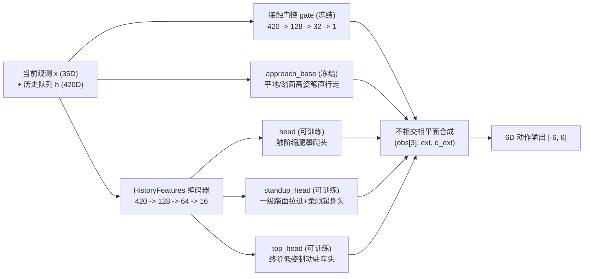

# MOD4v3 轮腿机器人多技能 RL 后训练标准配方（上台阶 + 压低大跳/移动连跳）

> **适用对象**：与 `MOD4v3 / HW300N60_R3` 同构型的双足并联四连杆（含气弹簧补偿）+ 双差速轮毂电机轮腿机器人。  
> **核心目标**：在不破坏基础全地形平顺运动专家（`E0`，`flat60 = 60/60` 零退化）的前提下，通过**解耦专家路由（MoE）+ 闭环 DAgger 热启动 + 零容忍反作弊 PPO + `0-DR -> Full-DR` 成功率门控课程**，高鲁棒性习得：
> 1. **优雅高姿上单阶（`20 cm`）与连续多级台阶（`20 cm + 20 cm = 40 cm`，踏面平滑起身衔接 + 台顶低姿零速驻车）**；
> 2. **深蹲蓄力原地大跳与边移动边连续大跳/跨栏（`33~35+ cm` 双轮离地净空，`0.0 ~ +1.2 / -0.5 m/s`）**。

---

## 一、 硬件控制契约与观测/动作标准接口

后训练同构型机器人时，必须先对齐以下底层控制频率与观测归一化约定（可用 [adapt_new_wheel_leg_robot.py](file:///d:/claude2/fangzhen/_mod4v2_src_20261106/sources/local/MOD4V3_POST_TRAINING_RECIPES_20261118/scripts/adapt_new_wheel_leg_robot.py) 自动换算新机型的派生阈值）：

| 维度 / 参数 | 标准设定（MOD4v3 基准） | 同构型新机器人迁移准则 |
| :--- | :--- | :--- |
| **物理步长 / 求解器** | `dt = 0.0025 s`（`400 Hz`），PhysX TGS `32 / 4` | 保持 `400 Hz` 物理步长与四连杆闭合刚度 |
| **执行器控制频率** | 腿部关节 PD `100 Hz`（4 分频），轮毂速度/力矩 `400 Hz`，策略 `50 Hz`（`0.02 s`） | 严禁将腿部与轮毂降频至 `50 Hz` 直接力矩 |
| **并联四连杆气弹簧** | `K_gas = 2000 N/m`，阻尼 `1.5 ~ 4.5 N·s/m`（DR 覆盖） | 按新机器人整机质量比 $M_{\text{new}} / M_{\text{mod4v3}}$ 线性缩放 PD 与气弹簧预紧 |
| **策略输入（Actor）** | 当前帧 `35D` + 历史队列 `H=12` 帧（`420D`，含当前帧，重置时首帧重复 12 次） | 无任何世界坐标 $x, z$ 或特权地形扫描输入，100% 本体感受可实机部署 |
| **价值网络输入（Critic）** | `78D` 特权状态（仅训练期 Critic 使用，推理期零依赖） | 独立 `E0 / E1 / E2` Critic 头，互不干扰 |
| **动作输出（`6D`）** | `[L_front, L_rear, R_front, R_rear, L_wheel, R_wheel]`，裁剪范围 `[-6.0, +6.0]` | `a_prev`（`obs[22:28]`）必须记录真实执行裁剪后的上一拍动作 |

### `35D` 本体观测逐维定义
- `obs[0:3]`：线速度/角速度指令 `[v_x_cmd, v_y_cmd, w_z_cmd]`
- `obs[3]`：目标机身相对地面高度指令 `h_cmd * 5.0`（高姿直走 `0.4091m -> 2.0455`，常规巡航 `0.28m -> 1.40`，台顶驻车低姿 `0.20m -> 1.00`）
- `obs[4:7]`：机体系角速度 $\boldsymbol{\omega}_b \times 0.5$
- `obs[7:10]`：机体系重力投影 $\mathbf{g}_b = \mathbf{R}^\top [0, 0, -1]^\top$
- `obs[10:16]`：相对默认零位的关节角偏差 `[q_leg(4), 0, 0]`（轮转角置零防漂移）
- `obs[16:22]`：关节角速度 $\dot{\mathbf{q}} \times 0.1$
- `obs[22:28]`：上一控制拍实际执行的 `6D` 动作 $\mathbf{a}_{t-1}$
- `obs[28:35]`：`7D` 技能路由模式位（常规运动 `[1,0,0,0,0,0,0]`；上台阶 `[0,1,0,0,0,1,0]`；RL 大跳/移动跳触发位 `obs[30]=1`）

---

## 二、 为什么不能用单一无门控 MLP 硬训全技能？（核心踩坑总结）

在多轮实测对比中，我们定位并彻底解决了五项导致轮腿上台阶/跳跃训练失败或退化的根因：

1. **平地高姿直走 vs 触墙收腿的梯度冲突（$\cos = -0.718$）**：单一 MLP 同时拟合平地高姿（`0.409m`）与爬阶缩腿（`0.175m`）会导致机器人在平地助跑段塌腰深蹲（`0.18m`）擦地左右抽搐。
   - **解法**：在专家内部采用**冻结平地高姿基座 `approach_base` + 纯历史接触门控 `gate` + 不相交相平面运动学门控 `(obs[3], ext, d_ext)`**，平地段 100% 笔直高姿零抽搐。
2. **蹭阶滑落刷分作弊（Touch-and-Slide Reward Hacking）**：仅给台顶触地密集分而不严惩滑落，策略会学会“单轮/双轮蹭一下阶顶拿分再滑下重刷”。
   - **解法**：建立 `s1_committed / s2_committed` 与单轮累计帧承诺机制——一旦上阶后任意轮高度跌破阶面安全阈值（`step_z + R_w - 0.035m`）或后退越过阶沿，**立即扣除 `-25.0` 追回罚分并当场终止回合（`reset_terminated = True`）**；单轮触顶且 `vx < 0.05 m/s` 密集奖严格置 `0`。
3. **二级台阶一级阶唇越边瞬间提前伸腿顶退**：双轮刚越过一级阶唇（`x ≈ 1.25m`）处于深蹲态（`ext ≈ -0.43`）时，若立即按 `h_cmd = 0.4091m` 伸腿会把轮胎反推下阶。
   - **解法**：利用纯关节角运动学伸展量
     $$\text{ext} = \frac{1}{4}\bigl((q_0 - q_1) + (q_2 - q_3)\bigr)$$
     与 `12` 帧历史差分 $d_{\text{ext}} = \text{ext}_t - \text{ext}_{t-11}$ 构造**完全不相交的相平面门控**，在深蹲落阶初期（过去 5 帧 $\max \text{ext} < -0.33$）平滑拉上踏面 `25~30 cm`，随后在 `1.5 m` 踏面上用 `0.6~0.8 s` 柔顺站高至 `0.409 m` 直走衔接二级台阶。
4. **`env.step()` 自动重置清零峰速绕过回放限速**：Isaac Lab `env.step()` 内部在 `timeout` 时先调用 `_reset_idx` 清零 `course_speed_max`，后读取会导致 `>0.60 m/s` 猛冲轨迹混入成功回放池。
   - **解法**：必须在 `_reset_idx` 之前将 `replay_episode_max_speed_at_step` 锁存到独立快照张量，严守 `<= 0.60 m/s` 入池。
5. **冷启动 Critic 冲击热启动 Actor**：直接联合更新会导致前 20 轮未收敛的 Value GAE 噪声冲垮精细预热的攀爬动作。
   - **解法**：强制执行 **前 15 轮 PPO 仅更新 Critic（Critic-Only Warmup）**，第 16 轮起再放开 Actor 小学习率（`6e-5 ~ 8e-5`）与低探索噪声（`STD = [0.01, 0.01, 0.01, 0.01, 0.02, 0.02]`）。

---

## 三、 配方 A：RL 连续多级上台阶（`MOD4V3_MOE_ROUTE2_CONTINUOUS_2STEP_ANTICHEAT_20261118`）

### 1. 网络与相平面门控架构（`StairExpert E1`）



- **四个完全不相交的相平面区域**：
  1. **平地及踏面高姿直走**（$\text{ext} \ge 0.195,\ g_{\text{climb}} \approx 0$）：输出 `approach_base`；
  2. **立面攀爬（一级与二级通用）**（$\text{ext} > -0.33$ 或正在收腿 $d_{\text{ext}} < 0$，$g_{\text{climb}} \to 1$）：输出 `head`；
  3. **中间级踏面拉进与柔顺站高**（`obs[3] > 1.7` 且满足深蹲落定 $\max_{k \in [-5,-1]} \text{ext}_k < -0.33$ 或正在伸腿起身 $d_{\text{ext}} > 0.020 \wedge \text{ext} < 0.195$）：输出 `standup_head`；
  4. **终阶台顶稳态与零速驻车**（双轮登顶终阶后 `obs[3] = 1.0 < 1.5`）：输出 `top_head`。

### 2. 三步标准复训流程
1. **阶段 1（本地 60 秒闭环 DAgger 热启动）**：
   运行 [build_2step_anticheat_step000.py](file:///d:/claude2/fangzhen/_mod4v2_src_20261106/sources/local/MOD4V3_MOE_ROUTE2_CONTINUOUS_2STEP_ANTICHEAT_20261118/build_2step_anticheat_step000.py) 生成 `weights/model_step000.pt`，并在 MuJoCo 独立验证单阶 `20 cm` 与连续二级 `20+20=40 cm` 视频及零滑落。
2. **阶段 2（远端 Isaac Sim `2048` 环境 `0-PPO` 预检）**：
   采样 `30%` 单阶 `20 cm` + `70%` 连续二级台阶（`1.5 m` 踏面，总高 `40 cm`），运行 `600` 步零更新预检，验证 Warp 烘焙网格高度、`E0` 零误差、全可训练参数梯度非零有限。
3. **阶段 3（反作弊渐进 DR PPO 主训练）**：
   - **课程晋级（`E1DRMixture`）**：
     - `Stage 0`：`0-DR` 中心起点 `0 mm`，`v_cmd = 0.47 m/s`（累计完成 $\ge 64$ 且近 128 回合成功率 $\ge 70\%$ 晋级）；
     - `Stage 1`：`0-DR` 五起点 `[-60, -30, 0, +30, +60] mm` 泛化，`v_cmd \in [0.35, 0.48] m/s`（每起点 $\ge 16$ 且近 256 回合 $\ge 70\%$ 晋级）；
     - `Stage 2 ~ 6`：按 `10% -> 25% -> 50% -> 75% -> 100%` 逐步激活完整 SCUT 全量物理 DR（质量、质心、关节摩擦、刚度阻尼、电机增益、`5~15 ms` 传感/动作延迟），仅统计真实开启 Full-DR 环境的成功次数晋级。
   - **四池隔离成功回放（`SuccessReplayPool`）**：`settle_high`（永久锁死 150 帧高姿静站不淘汰）、`approach`、`top_climb`、`top_park`，每小批次 `128` 帧 BC 正则（权重 `0.5`）+ 双侧动作对称损失（`0.45`）+ 前 `1s` 静站强锚定（`8.0`）。

---

## 四、 配方 B：RL 压低姿态蓄力大跳与边移动边连跳（`MOD4V3_RL_HIGH_MOVING_JUMP_20261118`）

### 1. 四阶段物理机制与纯神经网络内化
- **物理基线与演示源**：[MOD4V3_HIGH_MOVING_JUMP_20261118](file:///d:/claude2/fangzhen/_mod4v2_src_20261106/sources/local/MOD4V3_HIGH_MOVING_JUMP_20261118)（双轮离地净空 `33.23 ~ 35.70 cm`）。
- **纯 RL 网络输入输出**：同样严格采用 `obs(35) + history(420) -> action(6)`，无外部相位计时器、无世界高度 $z$ 特权输入：
  1. **深蹲蓄力（Crouch）**：收到跳跃触发位后快速下潜至机身高度 `0.188~0.194 m`（底盘/导轮零擦地），压缩并联气弹簧储能，轮毂前馈锁速；
  2. **爆发蹬伸（Explosive Push）**：双腿同步满幅伸展 + 俯仰角速度阻尼配平，实现原地与移动态近零俯仰起跳（空中 $|\text{pitch}| < 10^\circ$）；
  3. **空中收腿与 Raibert 落足预置（Flight Tuck）**：起跳离地瞬间主动快收双腿，额外赚取 `+12 ~ +15 cm` 轮底净空以跨越 `16~20 cm` 实体栏架，并按水平速度预置落足角；
  4. **单向天棚柔顺缓冲（Skyhook Absorb）**：触地顺势屈腿吸收冲击，抑制二次弹跳并在 `0.5 s` 内无缝恢复目标巡航速度或衔接下一跳。

### 2. 两阶段 RL 训练流水线
1. **阶段 1（多工况闭环 DAgger 热启动）**：覆盖 `vx_cmd \in [-0.6, 0.0, +0.4, +0.8, +1.2] m/s`、单跳、连续二/三连跳及 `14~20 cm` 跨栏场景采集闭环轨迹，训练纯历史条件 `E_jump` 专家。
2. **阶段 2（闭环 PPO + 渐进 DR 强化微调）**：
   - 奖励项：双轮同时离地净空峰值奖 + 跨栏越障奖 + 空中水平姿态保持奖 + 落地无擦地/低冲击天棚缓冲奖 + 前后巡航速度跟踪奖 - 非轮胎触地重罚；
   - 逐步注入质量 `±12%`、质心 `±2.5 cm`、地面摩擦 `0.55~1.15`、PD 增益 `±12%`、电机力矩上限 `±10%` 与 `0~20 ms` 延迟随机化，固化高鲁棒性权重 `model_rl_best.pt`。

---

## 五、 同构型新机器人一键迁移清单

1. **生成新机型适配配置**：
   ```powershell
   D:\claude2\fangzhen\.venv\Scripts\python.exe sources\local\MOD4V3_POST_TRAINING_RECIPES_20261118\scripts\adapt_new_wheel_leg_robot.py --spec-json your_robot_spec.json --out adapted_thresholds.json
   ```
2. **替换资产并校验闭合链与质量**：替换 MJCF / USD 与 `import_contract.json`，确认主动关节隐式刚度阻尼为 `0`、气弹簧刚度正确。
3. **运行 60 秒本地 DAgger 生成 `model_step000.pt` 与 `model_bc_dagger.pt`**，目视核验 `1x` 视频无抽搐、无擦地、无滑落。
4. **启动 `0-PPO` 预检 -> 渐进 DR PPO 训练**，以独立纯学生评测（`flat60` + 单阶/双阶五起点 + 移动连跳/跨栏 Full-DR）选出最优检查点归档。
