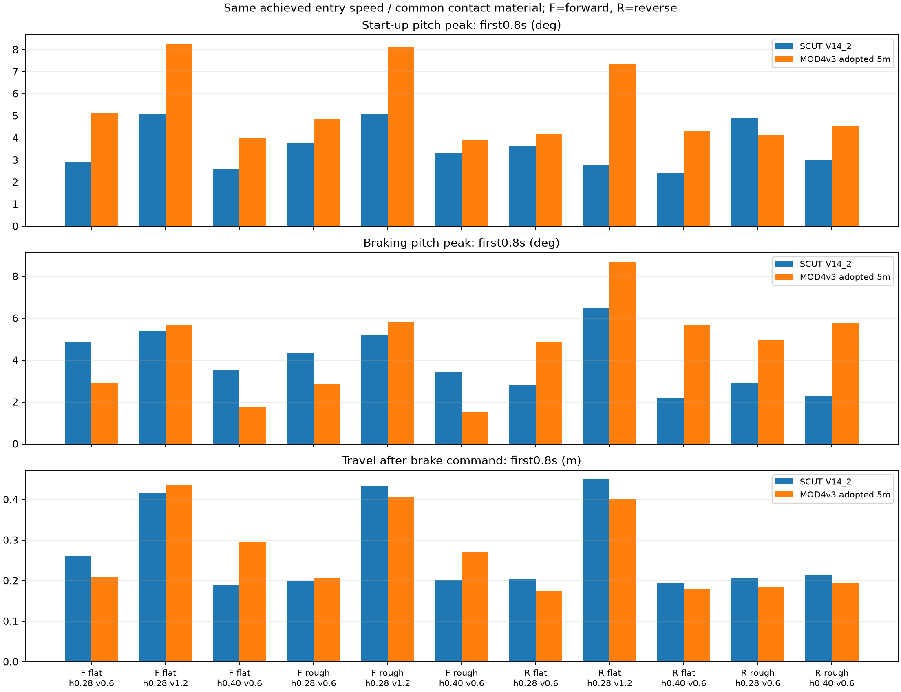
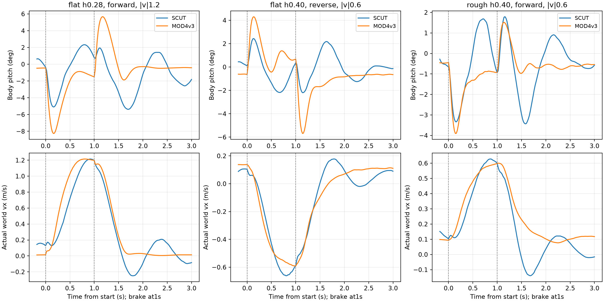

# 华南虎与11月16日低俯仰模型：同条件详细对照

本次使用华南虎原版d19492be/V14_2与当前已采用MOD4v3 c874a1af/iter25362。全部为MuJoCo冻结评测，无PPO更新，无默认替换。

## 核心结论

主对照共请求24组同实速配对，完成11组；其余13组按未匹配保留，不用低速峰值替代高速成绩。另有16组同指令配对(共32条5秒轨迹)全部完成。

同实速下差异具有方向性：前进急停6组中我们4组峰值更小，2组略大；后退急停5组中我们全部更大。起步峰值11组中我们10组更大。前进高站姿的较小急停角伴随更长停车路程，后退的较大角度伴随更短制动路程，必须合看。

## 相同与不同的条件

| 项目 | 本次统一条件 |
|---|---|
| 地形 | 同一181×181高度场，平地与官方L9起伏，尺寸/位置/内容SHA逐对一致 |
| 初始位置/姿态/速度 | x=-0.8,y=-0.1；单位四元数；qvel全0；各自合法闭链站姿 |
| 时间 | 先零指令2秒，恒定行驶指令1秒，硬切零指令停车2秒 |
| 接触材料 | 实际接触摩擦μ=1；其余摩擦.01/.01；solref=.02/1；solimp=.9/.95/.001/.5/2；condim=3 |
| 指令 | 高度0.28/0.40m、横向/偏航0；同指令试验为±1.2/±2.2m/s |
| 同实速 | 0.6/1.2/2.0m/s；独立校准两策略行驶指令幅度，单方误差≤0.01m/s，配对差≤0.02m/s |
| 噪声/保护 | 名义0延迟、无随机推扰；原2mm闭链保护保留；不注入轮矩或外力 |

保留差异：两者机器人不同，SCUT总质量25.102kg、MOD4v3为14.294kg；电机/弹簧/合法站姿不同。SCUT原配物理1ms、腿轮PD1kHz、Newton100次；MOD4v3原配2.5ms、腿100Hz/轮400Hz、Newton32次；策略均50Hz。没有把权重跨机体运行，也没有把控制时钟改成不匹配训练的版本。

“同实速”匹配的是刹车前世界水平速度与高度指令，不是全部入刹状态。实际高度、入刹俯仰/角速度、刹车位置和起步残余速度逐项存于JSON。尤其零速指令准备2秒后，SCUT仍有约0.10–0.20m/s前向残速，MOD4v3约0.01–0.14m/s；因此起步峰值是相同准备指令下的系统响应，不是相同初始实速或相同加速度的纯起步消融；11组中10组实际高度差≤2cm，剩余为起伏高站姿后退0.6m/s，差约2.4cm。同速校准的两者速度指令幅值不同；同指令试验另列，不能混称。

## 同实速逐工况：每个双值均为华南虎 / 我们

| 地形 | 高度指令m | 方向 | 目标实速 | 实际入刹m/s | 启动峰值° | 急停峰值° | 停车0.8s路程m |
|---|---:|---|---:|---:|---:|---:|---:|
|平地|0.28|前进|0.6|0.608/0.605|2.91/5.12|4.85/2.90|0.259/0.209|
|平地|0.28|前进|1.2|1.197/1.198|5.10/8.26|5.38/5.67|0.416/0.436|
|平地|0.40|前进|0.6|0.604/0.602|2.58/4.00|3.54/1.73|0.190/0.295|
|起伏L9|0.28|前进|0.6|0.598/0.599|3.77/4.87|4.32/2.87|0.199/0.206|
|起伏L9|0.28|前进|1.2|1.202/1.193|5.10/8.14|5.19/5.80|0.433/0.407|
|起伏L9|0.40|前进|0.6|0.600/0.599|3.34/3.90|3.43/1.52|0.202/0.271|
|平地|0.28|后退|0.6|0.590/0.595|3.65/4.21|2.78/4.87|0.204/0.173|
|平地|0.28|后退|1.2|1.201/1.197|2.78/7.37|6.50/8.70|0.450/0.402|
|平地|0.40|后退|0.6|0.590/0.592|2.43/4.31|2.20/5.69|0.196/0.178|
|起伏L9|0.28|后退|0.6|0.607/0.608|4.88/4.15|2.90/4.97|0.207/0.185|
|起伏L9|0.40|后退|0.6|0.603/0.607|3.01/4.54|2.31/5.77|0.213/0.193|

峰值窗口：起步最初0.8秒；急停指令前一帧至后0.8秒。路程是急停后0.8秒内世界x的绝对累计位移；它不是最终停车距离。完整2秒路程、完整2秒峰值、角速度、RMS和回稳时间另列下表。

## 角速度、完整停车过程与实际高度

持续回稳定义：实际平面速度<0.1m/s、俯仰绝对值<2°、俯仰角速度<0.2rad/s，从该时刻至2秒观察窗结束持续满足，且剩余观察至少0.2秒。按20ms采样；`>2s`代表本窗口未达到。仅首次连续满足0.2秒的时间另存JSON的first_hold02_time_s，不把随后再次离开稳定区间算作持续回稳。

| 工况 | 入刹实际高度m | 急停角速度峰值rad/s | 急停完整2s峰值° | 完整2s路程m | 回稳时间s |
|---|---:|---:|---:|---:|
|平地 h0.28 前进 0.6|0.284/0.274|0.678/0.953|4.85/2.90|0.385/0.219|>2s/0.50|
|平地 h0.28 前进 1.2|0.286/0.274|0.352/1.576|5.38/5.67|0.558/0.454|>2s/0.60|
|平地 h0.40 前进 0.6|0.384/0.389|0.485/0.645|3.54/1.73|0.266/0.459|1.42/>2s|
|起伏L9 h0.28 前进 0.6|0.289/0.281|0.546/0.923|4.32/2.87|0.313/0.258|>2s/0.52|
|起伏L9 h0.28 前进 1.2|0.295/0.279|0.390/1.599|5.19/5.80|0.600/0.451|>2s/0.64|
|起伏L9 h0.40 前进 0.6|0.390/0.396|0.544/0.632|3.43/1.52|0.272/0.396|1.44/>2s|
|平地 h0.28 后退 0.6|0.280/0.273|0.636/1.076|3.35/4.87|0.318/0.187|>2s/0.44|
|平地 h0.28 后退 1.2|0.279/0.274|0.898/1.981|6.50/8.70|0.608/0.415|>2s/0.62|
|平地 h0.40 后退 0.6|0.382/0.392|0.579/1.408|2.20/5.69|0.271/0.292|1.00/>2s|
|起伏L9 h0.28 后退 0.6|0.278/0.262|0.768/1.097|3.29/4.97|0.337/0.189|>2s/0.44|
|起伏L9 h0.40 后退 0.6|0.372/0.396|0.747/1.454|2.31/5.77|0.311/0.268|>2s/1.70|

## 对制动取舍的解释

前进高站姿0.6m/s：平地我们1.73°对SCUT3.54°，但0.8秒路程0.295m对0.190m，长55%；起伏我们1.52°对3.43°，路程0.271m对0.202m，长34%。这两组不能只凭俯仰称我们制动更好。

后退高站姿0.6m/s：平地我们5.69°对2.20°，为2.59倍，路程约短9%；起伏我们5.77°对2.31°，为2.50倍，路程约短10%。真实短板集中在后退及起步，而不是所有前进制动都超过两倍。

## 同指令、同材料、同时间表的逐工况

这些行不保证同实速，速度列是比较有效性的必要条件。全部双值仍为华南虎 / 我们；不与旧14秒原配接触材料结果混用。

| 地形 | 高度m | 方向 | 指令m/s | 实际入刹m/s | 启动峰值° | 急停峰值° | 0.8s路程m |
|---|---:|---|---:|---:|---:|---:|---:|
|平地|0.28|后退|1.2|1.265/1.070|2.29/6.82|7.70/7.90|0.539/0.345|
|平地|0.28|后退|2.2|0.134/1.994|1.55/10.05|1.55/13.27|0.071/0.903|
|平地|0.28|前进|1.2|1.516/1.176|5.19/8.17|5.11/5.56|0.714/0.427|
|平地|0.28|前进|2.2|0.999/2.138|3.44/11.09|5.96/12.47|0.516/1.121|
|平地|0.40|后退|1.2|0.897/0.730|1.82/5.15|5.90/6.64|0.464/0.235|
|平地|0.40|后退|2.2|0.066/1.430|0.41/8.40|0.97/11.16|0.051/0.626|
|平地|0.40|前进|1.2|0.971/1.411|2.52/7.59|5.43/5.65|0.494/0.730|
|平地|0.40|前进|2.2|0.238/2.115|0.37/9.33|1.81/11.34|0.092/1.432|
|起伏L9|0.28|后退|1.2|1.179/1.091|3.36/6.80|7.05/8.22|0.476/0.356|
|起伏L9|0.28|后退|2.2|0.131/1.993|2.25/10.03|1.53/12.94|0.111/0.855|
|起伏L9|0.28|前进|1.2|1.496/1.193|5.26/8.14|5.22/5.80|0.685/0.407|
|起伏L9|0.28|前进|2.2|0.696/2.111|3.52/11.10|5.07/14.21|0.338/1.036|
|起伏L9|0.40|后退|1.2|0.867/0.726|1.54/5.21|5.24/6.49|0.419/0.238|
|起伏L9|0.40|后退|2.2|0.060/1.465|0.67/8.63|0.93/11.08|0.062/0.628|
|起伏L9|0.40|前进|1.2|0.872/1.368|2.96/7.53|4.97/5.35|0.430/0.700|
|起伏L9|0.40|前进|2.2|0.130/2.101|0.90/9.27|0.76/11.20|0.047/1.353|

## 未获得有效同速配对的全部条件

指令幅值扫描0.3–2.7m/s，必要时局部二分10次。在固定1秒加速协议中未匹配，不等于模型绝对最高速度。没有用设初速/外力/延长运动时间来凑到目标。

| 地形 | 高度m | 方向 | 目标实速m/s | SCUT最接近有效值 | MOD4v3最接近有效值 |
|---|---:|---|---:|---:|---:|
|平地|0.28|后退|2.0|1.265|2.004|
|平地|0.28|前进|2.0|1.594|2.007|
|平地|0.40|后退|1.2|0.946|1.205|
|平地|0.40|后退|2.0|0.946|1.563|
|平地|0.40|前进|1.2|1.003|1.202|
|平地|0.40|前进|2.0|1.003|1.997|
|起伏L9|0.28|后退|1.2|1.179|1.194|
|起伏L9|0.28|后退|2.0|1.179|1.992|
|起伏L9|0.28|前进|2.0|1.537|2.001|
|起伏L9|0.40|后退|1.2|0.867|1.201|
|起伏L9|0.40|后退|2.0|0.867|1.610|
|起伏L9|0.40|前进|1.2|0.923|1.203|
|起伏L9|0.40|前进|2.0|0.923|1.994|

## 旧结果中必须补充的条件差异

首次编译核查证实：两者地形高度场相同，但旧SCUT实际轮地接触摩擦为5.5，MOD4v3为0.9；接触solref分别0.02和0.0012，solimp也不同。原先“相同地形/指令”不能等同于相同接触条件。先前240倍有效速度平方奖励的代数读回仍成立，但不能凭旧回放把全部俯仰差归给奖励。

本次先试共同较硬接触(.0012)与μ1，SCUT起伏在零指令准备0.06秒即触发倒地重置，故它不是高速急停失败或同速小俯仰样本。随后进行2种接触硬度×2种摩擦×2模型的8个站立诊断，证明共同较软接触(.02)与μ1下两者均能站稳，主对照使用此配置。初次硬接触结果、所有重置和诊断原始轨迹保留；共同较软配置是单一共同环境下的系统比较，不能外推所有接触材料。

## 结论边界与后续重点

这些结果支持优先处理启动俯仰与后退急停；前进高站姿则需要同时缩短停车路程，防止以慢制动换角度。两者本体和配套低层控制仍不同，本次不是同机体上的策略消融，也没有在同实际2.0m/s获得双方有效配对。由于每个条件是一条确定性名义轨迹，这些计数是工况覆盖，不是随机初态成功率或统计置信度。

完整数值：[COMPARISON.json](evidence/COMPARISON.json)。每个校准尝试、失败原因、最终轨迹路径和材料回读均保留于各worker的ATTEMPTS/RESULT。原始NPZ仅保留并作SHA索引，报告/代码/图/结果/失败日志进入本次Git记录。

执行修复：MOD4前进worker初次在构建第80个MuJoCo模型时内存分配失败；前79个尝试与9项结果保留，释放完成模型引用并收集Python循环后只接续未完成工况，见[MEMORY_REPAIR.json](MEMORY_REPAIR.json)。没有重放已完成训练或旧once。
