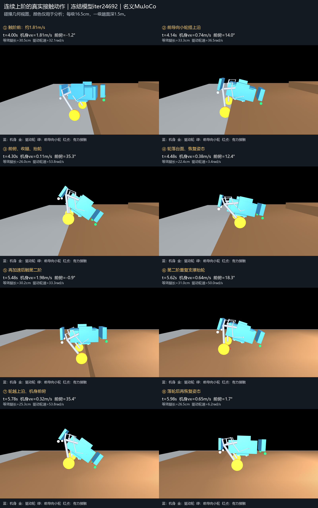
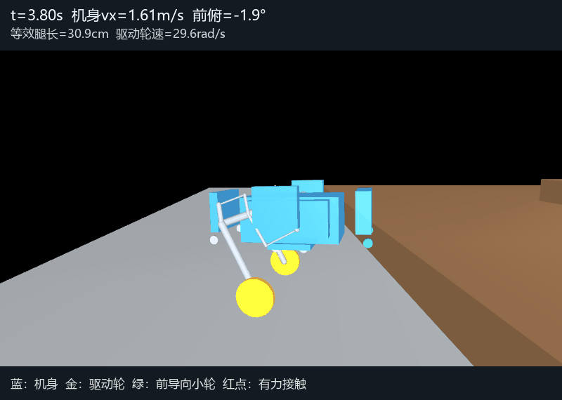
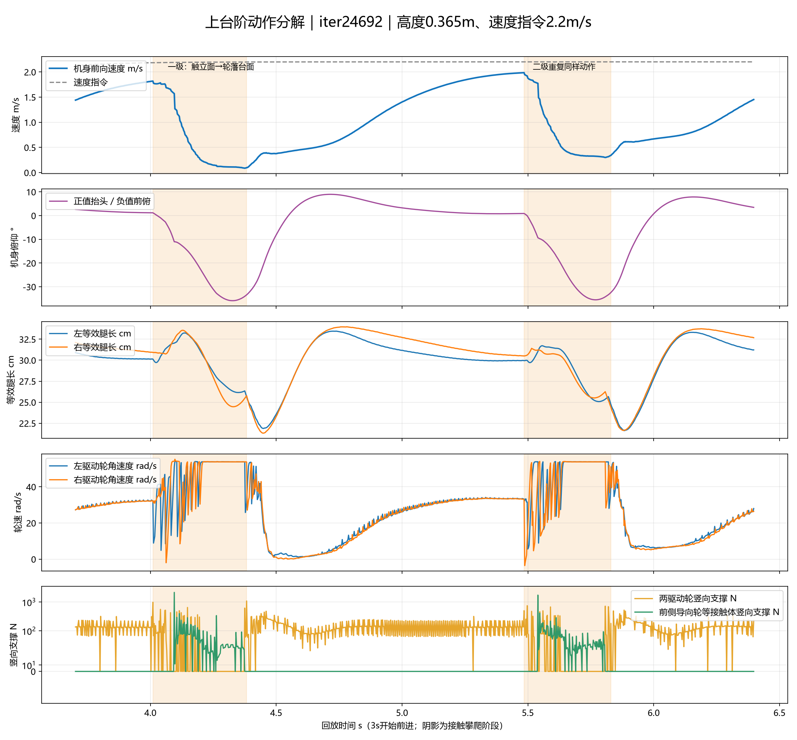

# 连续上台阶动作机制调查（2026-11-13）

## 结论

当前最优iter24692在该两级台阶上的动作是：**抬高底盘接近 → 驱动轮撞立面 → 前侧小导向轮搭上台面承力 → 机身前俯、收腿抬驱动轮 → 驱动轮落到台面 → 短时制动与伸腿恢复姿态 → 重新加速 → 下一阶重复。**

这是一种依赖入阶速度、前导向接触和大幅姿态过渡的逐阶攀爬。当前成功动作尚不是保持较高机身速度的连续登阶。轮子高速转动也不等于有同等的机身前进速度。

## 实验身份与范围

冻结模型：MOD4V3_FLAT_SPEED_REPAIR_20261112/weights/selected_flat_speed_candidate.pt，iter24692，SHA256 979e355a563b3057d7509e9e5ef33e7a364906bd80bd16789ad80df654efa64d。

沿用原R3资产、35维actor/78维critic/6动作、2.5ms物理/2.5ms轮反馈/10ms腿反馈/20ms策略、原电机包络、2mm单环境闭链/既有姿态与高度重置保护。未创建优化器、未修改策略、奖励或plant，未启动训练，不触碰人类现有MuJoCo窗口。

场景与前次保留验证相同：r00_c00，x正方向上行；第一级立面x=-2.9m，第二级x=-1.4m，每级0.165m，一级踏面深1.5m，最终平台高0.33m。没有在本轮偷偷缩短踏面或提高台阶。

四例各一个固定初态，其他DR为名义参数：

| 高度指令 | 速度指令 | 12秒内结果 |
|---|---|---|
| 0.365m | 2.2m/s | 两级成功，首次满足原终点条件6.22s |
| 0.400m | 2.2m/s | 两级成功，首次满足原终点条件6.06s |
| 0.365m | 1.0m/s | 未上一级；多次顶阶、后退、再接近 |
| 0.280m | 2.2m/s | 未上一级；前导向接触体与机身先被阶沿挡住 |

成功例在原终点条件后另观察0.36秒；失败例运行到12秒。四例均零重置，最大闭链分别0.480/0.423/0.682/0.281mm。两个成功例在原验收结束前的位置、速度、高度逐点与既有轨迹完全一致；这仅验证插桩未扰动旧回放，不增加课程毕业门槛。

低速组合改变了命令输入及实际入阶速度，不能由它单独断言机构存在某个绝对最低爬阶速度。四例也不是完整DR/PhysX成功率统计。

## 0.365m / 2.2m/s主例动作

1. **触阶前：** 4.010s左驱动轮首先碰一级立面，机身实际vx=1.818m/s，等效腿长均值30.5cm，机身接近水平。高度指令是回放上层提前从0.28m抬高到0.365m；不是策略看见台阶后自主改高度指令。
2. **搭上沿与前俯：** 约4.095s，模型的left/right_front_guide_link接触体开始从一级台面获得向上的支撑。具体几何为guide_wheel_04/06，半径15mm、半宽8mm的被动小导向轮。随后两驱动轮有明显卸载/离地时段，小导向轮持续参与支撑，不可把“两驱动轮没接触”直接叫成整机无支撑腾空。
3. **收腿抬轮：** 4.328s机身前俯约35.9°，驱动轮越过上沿；轮子转速接近54rad/s，轮动作进入6的裁剪上限，而机身降至约0.1m/s。此时轮速不能按纯滚动换算成机身速度。成功动作同时涉及接触支撑、机身旋转和腿部运动，不能归结为轮子直接滚上直立墙面。
4. **落轮和恢复：** 首个驱动轮在4.375s获得一级台面向上接触；两轮首次同时有大于5N的台面接触在4.4125s。最低机身vx约0.0865m/s恰在首次落轮附近。腿继续压缩到均值21.6cm（4.450s），再伸长恢复。4.41～4.72s窗口内，两轮同时出现负扭矩约42.5ms，两轮动作对应的目标轮速同时小于5rad/s约240ms；这包含姿态恢复，不应把所有负轮扭矩简单当作错误而删除。
5. **再加速冲二阶：** 从两轮首次同时支撑一级起，恢复到1.8m/s约需0.803s、向前0.759m。5.485s首次撞第二级立面时vx约1.985m/s。之后又经历前俯35.5°、抬轮、落轮、压腿和恢复。第二阶首次落轮5.8075s，最低vx约0.301m/s；两轮同时支撑5.8225s。

等效腿长定义为“驱动轮中心到同侧两个主动关节轴心中点的距离”，不是某根连杆实际长度。收腿最小值发生在落轮后的压缩段，不能全部算成触阶前主动收腿。

## 对此前表述的更正

此前把约0.09m/s称为“已经上一级后、在平台上失速”，时段不够准确。旧回放的ground字段由**机身根部的水平投影**查询地面高度，机身投影越过阶沿早于驱动轮落上台面。0.365m主例的旧ground字段约4.04s变成一级高度，但驱动轮到4.375s才首次落上一级台面。因此最低速度主要属于**第一阶的攀爬/落轮阶段**；后续另有低轮速恢复姿态和重新加速。

接触时间不再用机身投影过线代替。原统计和原始文件保留，当前报告追加解释，不改写旧结果。

## 为什么紧接着上下一阶会困难

直接证据是：每一级都消耗一个明显的“撞阶—前俯抬轮—落轮压缩—站回去—再加速”周期。旧一级踏面1.5m，足以让它在第二阶前重新达到接近2m/s。踏面更短时，下一级可能在低轮速或姿态尚未恢复时就到达，当前动作未必衔接得上。**这是基于已测动作的机制推断，本轮未试验更短踏面，不能冒称已测出窄阶阈值。**

四例还区分了两种失败：高姿低速组合没完成所需的抬轮/前俯过程，低姿高速组合则先发生导向接触体/机身被阶沿阻挡。单纯把速度命令继续增大不能覆盖所有失败。

## 对下一轮连续上阶训练的具体含义

- 主体样本应是完整连续两级/多级，覆盖实际目标踏面深度与助跑条件；保留少量中间阶低速有效状态练恢复。
- 优化落轮、伸腿、姿态恢复与下一阶抬轮的衔接，减少每一级都完整站回去后再冲的依赖。目标是整段通过率和阶间时间，而非触阶全程强迫机身vx保持2.2m/s。
- 原台阶附加进展奖励在scut_rough_stair_lift_env.py第110行要求abs(pitch)<0.45rad，约25.8°；已测成功攀爬前俯约35.9°，关键动作段会不满足这项额外奖励的valid条件。它是需要修正的任务奖励定义，不能直接当成全部失败的唯一根因。既有安全重置规则保持。
- 同一附加进展奖励还乘5cm宽的高度误差门控。压腿/翻越阶段应检查这项门控是否压掉有效进展，完成二阶的奖励应独立于瞬时的站立高度跟踪。
- 保留平地速度修复和原有技能验收；在连续阶梯上比较第一阶落轮后至下一阶接触/落轮的耗时、实际进阶速度和整段通过。负轮扭矩有平衡作用，不能硬性禁止制动或只奖励轮子空转得快。

本轮只完成动作调查和冻结回放；以上训练修改尚未实施或开训。

## 证据与复现

capture_motion.py生成4例物理子步trajectory.npz、contacts.jsonl、50Hz观测/动作与原回放轨迹；analyze_motion.py生成每例MOTION_METRICS、MOTION_SUMMARY、VALIDATION与曲线；render_motion.py从记录状态单独mj_forward渲染半速GIF与关键帧。图中只显示实际碰撞几何并改显示颜色：蓝机身、金驱动轮、绿前导向小轮、红点是大于5N接触，渲染没有用于物理仿真。支撑曲线使用对称对数纵轴以同时展示持续支撑和短时冲击峰。

采样对齐：implicitfast每步缓存积分前q/v/t，mj_step之后的运动学、接触和求解力与该积分前状态配对；用独立数据重建的轮位置与记录完全一致。静止接触竖向合力约139.7N，与总重140.2N一致，检验了接触局部坐标到世界坐标和作用方向。

关节机械功按实际广义驱动力矩乘关节速度积分；正功、负功与被动弹簧/接触功不同，不能仅凭正功占比证明能量来源。完整四例与失败均保留，不作模型晋升或实车部署声明。运行环境Python3.13.15、MuJoCo3.12.0、Torch2.14.0+cpu、NumPy2.5.2，详见REPLAY_COMPLETE.json。模型本体已在前次Git中完整保存，本阶段引用相同完整PT和SHA，不生成新权重。
