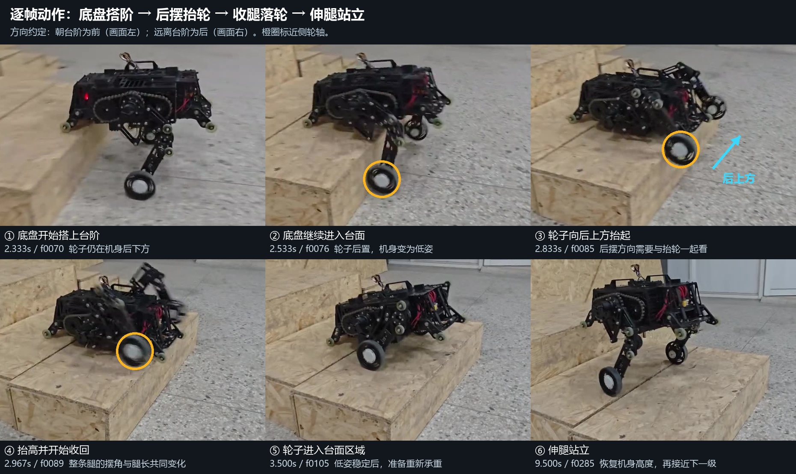

# 参考视频：底盘搭阶后的后摆抬轮

用户明确指出：底盘大部分爬上台面后，轮子先向后抬起，然后收腿站立。此处“前”统一指朝上层台面方向，“后”指离开台阶方向；描述的是轮轴相对机身的运动，不代表轮毂电机反转指令。

原文件：`C:/Users/lulunomaro/Desktop/43574887781-1-192.mp4`。SHA256：`360fd0401a377f15cb582dd0416328bd75b671136271134b3db0f5e88ac8e43e`。容器时长143.48秒，1280×720，约30fps；共解码4302个原始视频帧，末帧时间143.398938秒。原始文件保持不变。全片时间轴用于定位；第一次两级登阶关键片段按连续原始帧检查，另四次上阶用时间轴交叉对照。没有把“解码全片”冒充“逐张目视全部4302帧”。精确时间以`evidence/FRAME_INDEX.json`里的原始PTS为准。



| 原始时间 | 逐帧观察 | 动作意义 |
|---|---|---|
| 约2.17–2.37秒 | 机身接近并搭到上层台面；主轮仍在下层、位于机身后下方 | 先把机身送到可支撑的位置 |
| 约2.43–2.67秒 | 更多底盘进入台面，机身相对台面变为低姿，轮子仍留在台阶外侧；轮轴开始向机身后方摆 | 底盘搭阶与轮子后置是同一接触切换过程 |
| 约2.67–2.93秒 | 近侧轮轴明显向后上方移动，远侧轮的相位略早 | 存在明确的后摆抬轮轨迹；不能只用腿长缩短描述 |
| 约2.93–3.50秒 | 腿轮继续改变摆角，轮子收进台面区域，低姿稳定 | 抬过边缘后完成收回和落轮；落轮受力不能仅凭图像量化 |
| 约7.8–10.0秒 | 两条腿逐渐伸长，底盘重新升高 | 站立发生在轮子进入台面以后 |
| 约12.3–13.3秒 | 第二级重复搭底盘、后上方抬轮、收回的动作 | 第一次录像在级间存在数秒停留及重新站高 |

物理解释：从姿态与接触位置看，台面通过底盘/前部导向轮暂时参与支撑，使主轮能够卸载并被腿机构搬到上层。后摆使轮轴先朝远离立面的方向运动，并与抬升共同形成绕边轨迹；待轮子进入上层后再重新承重、伸腿。支撑力大小和真实质心投影需要仿真接触力或实测数据，本视频没有提供这些量。

这支持用户提出的低速登阶路线：触阶以后依靠支撑转换与后摆搬轮完成上阶。视频存在接近台阶时的平移，拍摄镜头也在跟随，无法由此标出精确m/s或断言全程零惯性。第一次连续两阶之间有明显停顿，因此后续还要验证缩短级间停留后的通过能力。

当前训练代码核对位置：`sources/local/MOD4V3_HIGH_STANCE_CONTINUE_2H_20261114/support/mod4v3_ppo_v1/continuous_stair_env.py:145–150`。抬轮项实际计算为：

```text
lift = clamp((wheel_z - lower_tread_z - wheel_radius) / 0.2, 0, 1)
retract = clamp((length_at_arm - current_length) / 0.08, 0, 1)
score = lift * retract
lift_gain = positive_increase_of_historical_best(score)
```

这一项衡量抬轮高度和腿长缩短，触发范围看轮子是否靠近阶沿；它没有显式衡量轮轴相对机身的后摆，也没有以底盘已形成台面支撑作为触发条件。方向正确但腿长未缩短时，这一项本身为0，其他基础奖励与真实落轮奖励仍存在。教师示范可能已经隐含后摆；本次未用视频替代策略回放归因，尚不能认定这是现有失败的唯一根因。

冻结的MOD4/R3 MJCF也有8个前后及底部导向轮刚体/碰撞体，模型SHA为`77904c001262d53bdb5ec59b270dc24588b7c1aee8c9ba59d8c85074720c8d8f`。本次发现不要求更换机器人模型。

建议下一个受控回放问题保持单一：从“底盘已搭阶、主轮仍在后下方”的低速状态出发，记录轮轴相对机身的前后位置、轮底相对阶沿净空、腿长、底盘/导向轮与主轮接触力，确认是否能完成“支撑成立→后摆抬轮→上层落轮→伸腿”。只有上阶且处于搬轮阶段才考虑方向反馈；平地、rough保留项继续按原配方。后摆方向用轮轴相对机身的位置表达，不能直接猜左右电机的正负号。奖励或策略原因要由这个回放结果判断。

文件：`KEY_FRAMES_REARWARD_SWING.jpg`是标注关键帧；`REARWARD_SWING_025X.mp4`是原片2.166667–3.666667秒的0.25倍速静音片段；`continuous/first_contact_every_frame_*`与`continuous/second_step_every_frame_*`保留首次两级的连续帧拼图；`timeline/`用于重复周期对照。原始逐帧JPEG位于FRAME_INDEX记录的本机临时目录，不需要将4302张临时帧全部提交Git。

本记录是视频动作与冻结源码的诊断归档。当前训练窗口、奖励、DR、资产、闭链保护和策略接口未因本诊断修改；未启动额外训练。
