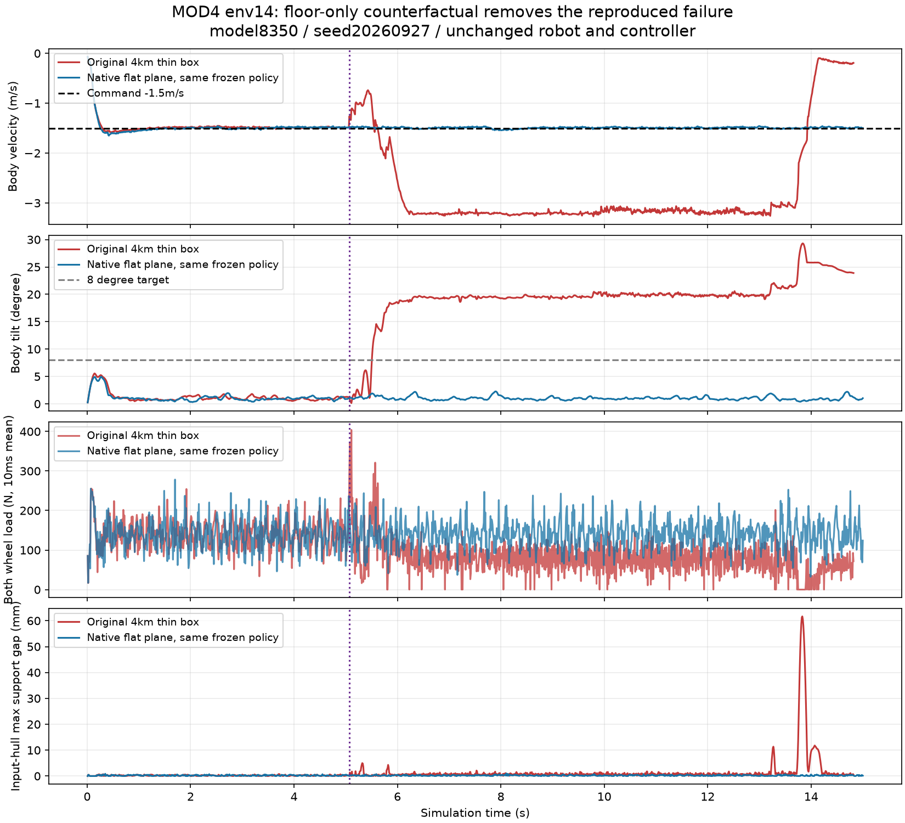
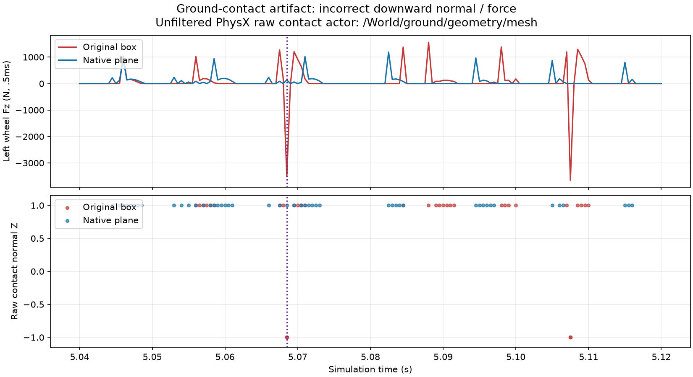

# MOD4 接触失稳原因排查与平地地板修复候选

日期：2026-09-30。原生产目录：`/home/egde/rl_candidates/MOD4_contact_integrated_repair_20260930`。

## 结论

**找到并通过对照确认了一项真实物理问题：4 km × 4 km × 0.1 m 的超大薄地板，在可复现样本中产生了方向错误的地面接触。只更换地板，同一份策略即可消除这次失稳。**

证据支持修复地板，不能把所有历史失败都归因于它。具体底层原因是数值精度、PCM 特征选择还是其他 PhysX 接触算法问题，本次没有进一步区分。

已实现本地生成的原生 `Plane` 候选，无需下载 NVIDIA 地板资产。只用于平地；底盘 USD、四腿两轮电机、气弹簧、PD、奖励、观测、PPO 和关节约束均保持原样。原生产源码没有修改，本次没有新增 PPO 训练。

## 怎样查出来的

1. 冻结 `model8350`，seed `20260927`，80 个环境，每环境 1500 个控制步（15 秒）。负向匀速组是交错编号 `4/14/24/34/44/54/64/74`，不是连续八行。
2. 原失稳样本 env14 精确复现，14.83 秒触发失败。先在约 5.07 秒出现左轮转速冲击，随后策略把轮速目标推到 −60 rad/s，进入长时间裁剪和倾斜。
3. 仅在冲击后将该样本轮速目标限制到 ±35 rad/s，冲击前 507 帧全部已记录数组的最大差严格为零。限速降低了饱和和超速，但平均倾斜仍约 13.5°，未恢复平稳。因此这个限速补丁不部署。
4. 直接读取 PhysX **未过滤的原始接触点、法向、力和 other_actor ID**，每 0.5 ms 采样。冲击对象为 `/World/ground/geometry/mesh`。记录窗口 4.9–5.3 秒内，原地板出现 9 条承载力大于 1 N 的向下法向接触。
5. 最早反向接触在 **5.0685 秒**：法向 Z≈−1；一个接触点的力约 **2698 N**；点高约 126.9 mm，却报告 separation≈**−226.9 mm**。该子步四个接触点合计约 **−3514 N 的竖向力**，与实际净力记录一致。平地上方的轮子不应受到来自地板下表面的向下承载力。
6. 地板单因素对照分别改成 200 m 小地板、原生无限平面，机器人及控制参数不变、没有重新训练；两者均消除了该样本失稳。上述接触窗口中未再出现向下承载法向。

原始接触读取探针与原复现前 6 秒的动作、q、qd、根位置和角速度数组严格一致。它没有改变原失稳轨迹。

早期“过滤力矩阵”尝试连正常承载的地面力都返回零，属于**无效的排除证据**，不能拿它声称“没有接触”。最终结论采用未过滤 raw contact actor ID。运行期环境碰撞过滤已开启，场景反向过滤属性为 True；接触证据指向地板，无需靠邻近机器人距离猜测原因。

## 同一失败样本的结果

下面是原验收协议的 env14 汇总，已排除首次失败后自动复位的数据。原版本统计到首次失败；三个对照统计满 15 秒。因此不是完全相同长度的稳态平均。

| 地板/干预 | 15 秒存活 | 平均速度误差 | 平均倾斜 | 最大倾斜 | 最长双轮低于 1 N | 轮力矩裁剪比例 |
|---|---:|---:|---:|---:|---:|---:|
| 原 4 km 薄地板 | 否 | 1.021 m/s | 13.555° | 29.296° | 164 ms | 65.96% |
| 原地板，仅冲击后限轮速 | 是 | 0.323 m/s | 13.519° | 22.144° | 24 ms | 1.24% |
| 200 m 地板 | 是 | 0.0146 m/s | 0.970° | 2.100° | 9.5 ms | 0.55% |
| 原生平面 | 是 | 0.0162 m/s | 0.991° | 2.269° | 10.5 ms | 0.62% |

原生平面的 80 个样本均存活，闭链最大残差约 **0.126 mm**，耦合最大残差约 **0.00169 rad**。这是 15 秒隔离仿真验收，不是长时间、DR、多地形或实车认证。

## 最新策略目前怎样

原训练按既有预算在北京时间约 **14:33:53** 截止，完整保存 `model8648.pt` 后退出。没有延长预算，小时巡检自动化 `mod4-10` 已在终验结束后删除。诊断之后进行的都是冻结策略回放，没有 PPO 更新。

最新检查点：

`logs/2026-09-30_10-45-56_scut_straight_1.5m_repair/model_8648.pt`

SHA256：`343c56615e7ee6708a6a6a8057cb30877f5ea83d9a2249e079a991db522196d2`。

CPU 回读确认 actor、critic、optimizer、std、iteration 齐全，68 个浮点张量均有限。不要从零开始，也不要用测速或诊断脚本的临时权重替代它。

原地板最终回放 seed20260926、80env×15s，80 个样本全部存活；±1.5m/s 匀速平均误差约 0.021–0.025m/s，平均倾斜约 1.15–1.28°。旧端点窗口接触门槛仍未通过。不能把 model8350 的单个异常等同于最新策略普遍崩溃。

最新 model8648 还在原生平面上做了同 seed20260926、80env×15s 兼容性回放，见 `native_plane_latest_reproduction.json`：80 个样本全存活，±1.5m/s 匀速平均误差约 0.018–0.023m/s、倾斜约 1.14–1.26°；闭链最大约 0.126mm、耦合最大约 0.00183rad。旧窗口接触门槛仍未通过。这仍是冻结权重验收，没有训练。

## 哪些结论仍然不能下

- ±60rad/s 轮速目标高于当前模型约 55.36rad/s 的空载速度，是恢复阶段的风险；它不是本次最早地面冲击的原因。不能据此增加电机功率或盲调力矩上限。
- 右髋 PD 目标超过 +0.5rad 机械范围的现象仍存在；健康地板下同策略也能跑稳，所以不能仅凭“顶限”判为本次原因。直接截断腿目标可能改变支撑力，需另作对照。
- 本次没有修改弹簧仍能消除这次失败，不能据此说弹簧已正确标定。当前模型为 3500N/m 预载形式，300–700N 实物力—行程 DR 仍未完成。
- 5 ms 均力积分修复的是奖励采样语义。它不会自动修好异常碰撞，也不代表连续承重或学习进步。
- 原生平面下仍有约 10 ms 的低力区间。低力不是腾空；必须保留实际载荷冲量、连续低载时长、支撑间隙和滑移指标。
- 支撑间隙及滑移来自每 10 ms 的输入轮网格最低支撑点近似，未包括 PhysX cooking/offset/compliance，不是接触流形滑移。0.5 ms raw contact 证据与这些近似应分开解读。
- 2m/s 本次仅有缓升、刹停、反向外推；没有证明匀速突变 2m/s、DR、Rough 或实车鲁棒。

## 交给下一位 AI 的执行顺序

1. 保留已完成原目录和所有检查点，在**单独复制的任务目录**应用 `apply_native_floor_fix.py`；该脚本按源码 SHA 校验，拒绝修改原目录、拒绝活跃进程目录，只改变平地地板。
2. 用新任务自己的 USD/电机/弹簧映射检查，加上子步原始地面法向和分离距离审计；禁止只盯汇总奖励。
3. 在 20000env 下做新地板短时接触和内存预检；本包只实测 80env，不冒称已经完成 20k 回归。
4. 如果用户给出新训练预算，再从完整 model8648 恢复 actor/critic/optimizer/std，保持 20k×24、solver16/4、±1.5m/s、root.25m、10%站立、DR关闭，先巩固修正地板后的平地策略。不要重跑旧一次性交接监督器，也不要沿用过期 deadline。
5. 做同 seed、逐环境、多 seed 和更长时段验收，保留旧窗口、5ms端点及均力积分三套口径。修复统计口径不能冒充物理改善。
6. ±1.5m/s 稳定后按已保存速度课程验证 ±2m/s 匀速、突变、加减速、停车；随后才验证轻度 DR 和华南虎 V14 Rough v1。不要同时调整奖励、弹簧、轮网格、髋限位和 PPO。

200 m 地板仅用于证明原因；20k 环境不能直接照搬它，以免机器人跑出地板。交付修复候选采用原生无限平面。

## 2026-10-01 接入预检修复

实际部署预检发现原补丁把生成函数导入放在 Mod4SceneCfg 类内部，Isaac Lab configclass 将其登记为场景成员，导致 Unknown asset config type。补丁已改为模块级导入，仍只改变平地生成方式。此前 80env15s 的物理对照通过直接配置函数运行，不受此类成员问题影响；之前的解析测试不能替代实际配置类接入测试。大规模/PPO结果以新训练目录 reports 为准。
