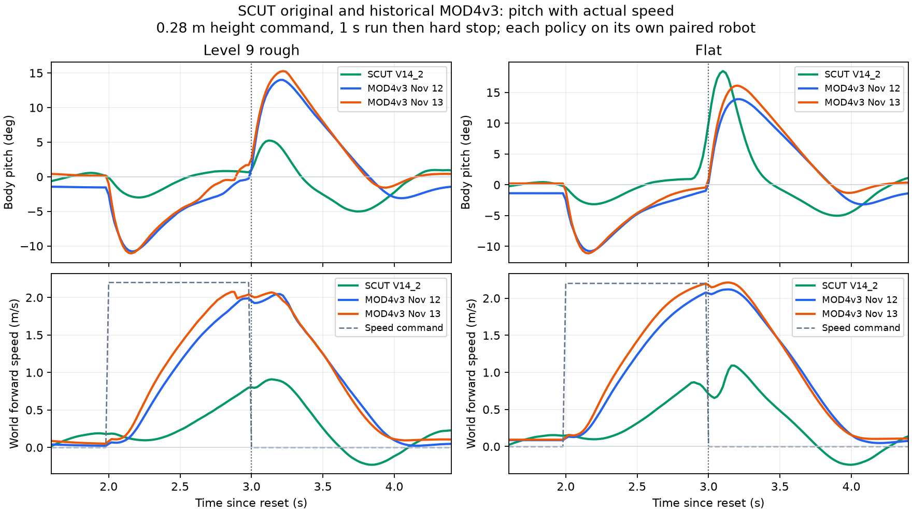

# 华南虎原版权重俯仰核查（2026-11-16）

使用此前华南虎WASD回放窗口的同一份公开权重：`rough_rotation_stair/2026-07-23_16-23-21/model_1000.pt`，iteration1000，SHA256 `d19492be858ffd431a67e5aa40afb4a4c51dc9a1c914c5c92022ed46d5868db7`。机器人使用作者ROS2 sim2sim资源V14_2，XML SHA256 `60518f64de99edbaa9197c8a9f6f6ac9097e831204df3ad60b4c565e6f77b6f6`。权重与原归档PT逐一SHA核对。当前生产MOD4v3、默认权重、原播放器和训练配方均未修改。

## 固定启停结果

同一组官方random_uniform level9与plane level0地形、0.28/0.40 m高度指令、1.2/2.2 m/s速度指令，共8条14秒轨迹；先站立2秒，再1秒硬起步、2秒硬停车，正反交替。起点x=-0.8，y=-0.1/+0.1，与此前MOD4v3俯仰测试相同。俯仰由机身实际重力投影计算，角速度由MuJoCo局部机体速度读取。沿用作者参考播放器的1ms物理、1kHz腿/轮PD、50Hz策略、2mm闭链保护与原弹簧公式；未触发跳跃，未修改策略动作或注入外力。

|地面|模型|俯仰RMS均值|启动最大俯仰|急停最大俯仰|
|---|---|---:|---:|---:|
|9级崎岖|华南虎原版|1.70°|4.87°|6.98°|
|9级崎岖|我们的11月12日|4.49°|10.78°|15.30°|
|9级崎岖|我们的11月13日|5.68°|12.29°|22.64°|
|平地|华南虎原版|2.12°|5.73°|18.46°|
|平地|我们的11月12日|4.54°|10.77°|15.14°|
|平地|我们的11月13日|5.55°|12.21°|18.67°|

华南虎8/8工况完整完成，无重置；本次最大闭链误差约0.658mm。RMS是各地面4个工况RMS的算术均值，峰值取对应启动/急停0.8秒窗口的绝对角度最大值。11月13日MOD4v3两条高姿高速工况在地形边界提前终止，RMS覆盖时长略有差异。参考结果复用既有原始JSON与轨迹，没有重跑旧评测。

## 速度必须一起看

华南虎在部分工况中俯仰较小，但短起步阶段的速度跟踪并不充分。不能把低俯仰直接解释成同速制动性能更好，也不能只凭RMS宣布所有启停都平稳：0.28m、2.2m/s指令的平地第一次急停仍有18.463°峰值，当时入刹实速约0.755m/s。

|地面|高度指令m|速度指令m/s|首次入刹世界实速m/s|启动峰值|急停峰值|
|---|---:|---:|---:|---:|---:|
|9级崎岖|0.28|1.2|1.489|4.87°|6.98°|
|9级崎岖|0.28|2.2|0.799|3.02°|6.02°|
|9级崎岖|0.40|1.2|0.891|2.77°|6.04°|
|9级崎岖|0.40|2.2|0.147|0.65°|1.32°|
|平地|0.28|1.2|0.614|5.73°|8.99°|
|平地|0.28|2.2|0.755|3.15°|18.46°|
|平地|0.40|1.2|0.985|2.28°|5.91°|
|平地|0.40|2.2|0.223|0.93°|1.88°|

0.40m、2.2m/s指令的首次入刹实速：华南虎崎岖0.147m/s、平地0.223m/s；对应我们的11月12日约1.476/1.459m/s、11月13日约2.078/2.125m/s。华南虎在这两个工况接近站立，不能作为高速小俯仰的成功样本。0.28m、2.2m/s指令时华南虎也只有约0.799/0.755m/s，仍明显低于我们的模型。

部分低速条件确有参考价值：0.28m、1.2m/s指令的崎岖工况，华南虎首次入刹实速1.489m/s、首次急停峰值5.085°；11月13日模型约1.271m/s、8.017°。不过机器人与控制器不同，这个差别仍不能只归功于策略。

保存配置的速度范围包含±2.7m/s、高度范围0.20–0.42m，vel_height_gate_enabled=false。因此不能在没有证据时把2.2m/s下的速度跟踪异常归因于超出保存指令范围或高度速度门控。当前仅记录其MuJoCo回放表现，未完成速度跟踪异常的归因。

## 对比范围及证据

这里测的是原版SCUT策略配作者V14_2参考MuJoCo机器人；我们的策略配MOD4v3。两者机体、弹簧、电机包络与PD/物理频率不同。SCUT参考MJCF固定云台、未包含原Isaac USD导轮拓扑，因此本结果不是原生PhysX或真机同速验收。所有数据均为名义0ms延迟、无随机推扰测试。

`evaluate_pitch.py`为本次唯一新增评测脚本；它直接调用已归档SCUT后端，运行输出隔离于本目录runtime，不接管现有窗口。在guard自动reset前只读采集状态，避免将重置后姿态计入失败峰值；本次没有reset事件。`PLAN.json`保存模型/资产/配置/源码指纹与完整调用命令。`evidence/RESULT.json`保存8条逐工况实测，`COMPILED_CONTROL.json`保存编译参数，`THREE_MODEL_COMPARISON.json`保存统一世界x差分实速与首次停车对照。原始轨迹、生成场景、配置和已有权重按`ARTIFACT_INDEX.json`索引，原件保留实际路径；文本报告、代码、结果和图随本次trial进入Git。无PPO更新、无默认模型晋升。
